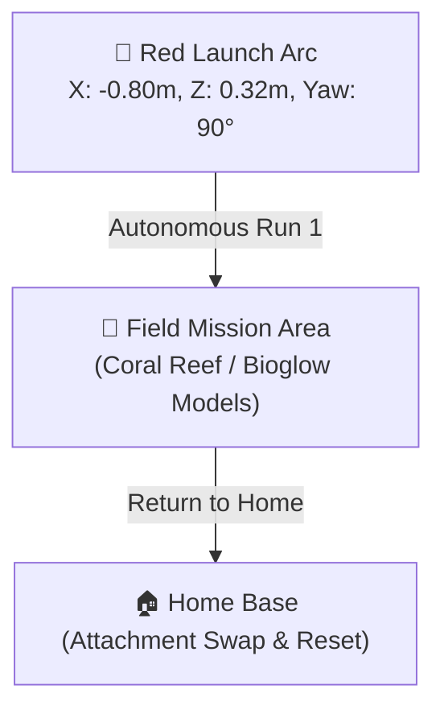
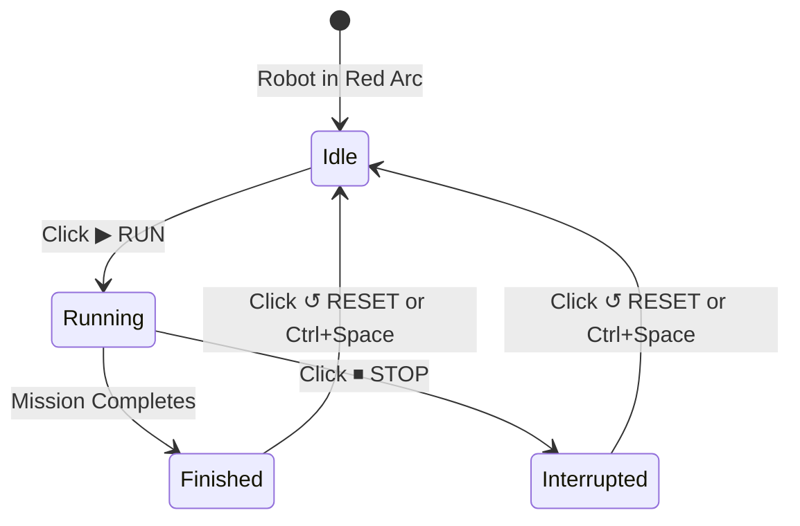

# Tutorial 1: Navigating the 3D Mat & Your First Autonomous Run

Welcome to your first hands-on session with the **FLL Robot Simulator (`fll-sim`)**! In this tutorial, you will explore the virtual 4x8 ft competition table, master camera navigation, launch your first autonomous robot run, inspect live sensor telemetry, and practice resetting the table with keyboard hotkeys.

---

## 🎯 Learning Objectives

By the end of this tutorial, you will be able to:

1. Identify the official dimensions and key coordinate regions of the competition mat, including the **Red Launch Arc**.
2. Seamlessly toggle between the **Top-Down Programming Camera** and the **3D Isometric View**.
3. Load and execute an autonomous Python mission using the simulator top bar.
4. Read real-time telemetry from wheel motor encoders, optical color sensors, ultrasonic sonar, and the internal Gyro IMU.
5. Instantaneously reset the robot to its exact starting pose using `↺ RESET` and keyboard hotkeys.
6. Complete **Hands-On Challenge 1** by writing and verifying a calibrated autonomous drive routine.

---

## 🛠️ Step 1: Launching the Simulator and Understanding the 4x8 ft Competition Table

When you open `fll-sim` in your browser (or run `npm run dev` locally), the complete 3D simulation environment renders in your browser window:


### The Anatomy of an FLL Competition Table

The competition table modeled in `fll-sim` matches the official *FIRST*® LEGO® League specifications:

* **Field Mat Dimensions**: Standard 4x8 ft arena (approximately $2.362\,\text{m} \times 1.143\,\text{m}$).
* **Boundary Walls**: Technic wooden perimeter borders with authentic collision friction and restitution.
* **Coordinate Grid**: 
    * The center of the mat is defined at `X = 0.00 m, Z = 0.00 m`.
    * **X-Axis**: Longitudinal axis along the length of the table (East/West direction).
    * **Z-Axis**: Transverse axis across the width of the table (North/South direction).
    * **Y-Axis**: Vertical height above the vinyl surface (Ground level = `Y = 0.00 m`).

!!! note "Understanding Units in Robotics"
    In professional robotics and FLL competition rules, physical measurements are expressed in the Metric system. While the field table frame is colloquially referred to as "4x8 feet", all internal physics, sensor distances, and Python drive distances in `fll-sim` operate in **centimeters (cm)** and **meters (m)**.

---

## 🚩 Step 2: The Red Launch Arc and Starting Pose

At the beginning of an official 2.5-minute FLL Robot Game match, your robot must begin completely inside one of the **Launch Areas** (the Red or Blue Home Arcs) on the edge of the mat.

In `fll-sim`, the default spawn pose positions the robot inside the **Red Launch Arc**:

* **Default Position**: `X = -0.80 m, Z = 0.32 m`
* **Default Heading (Yaw)**: `90.0°` (pointing directly East toward the field mission models)
* **Match Timer**: Set to `02:30` (counts down dynamically during active runs)



You can view and modify the starting position anytime by clicking the **⚙️ Field** button on the left activity bar. You can choose quick presets (`🚩 Red Arc`, `🔷 Blue Arc`, or `🎯 Center`), adjust the coordinates in millimeters, or rotate the heading by clicking `⟲ -45°`, `⟳ +45°`, or cardinal presets (`0° N`, `90° E`, `180° S`, `270° W`). Once you have placed the robot in your desired spot, click **📌 Set as Start** to lock it in!

---

## 🎥 Step 3: Top-Down Programming Camera vs. 3D Isometric View

Clear spatial perspective is crucial when debugging robot navigation. In the top bar, you have three dedicated camera presets:

```
[ 📐 3D Iso ]   [ 🗺️ Top-Down ]   [ 🎥 Follow ]
```


### 1. `🗺️ Top-Down` (Programming & Navigation View)
* **What it does**: Positions an orthographic-style overhead camera looking straight down at the field mat.
* **When to use it**: When designing line-following routes, measuring travel distances between mission models, and verifying that your robot drives in straight parallel lines without drifting.

### 2. `📐 3D Iso` (Spatial & Attachment View)
* **What it does**: Positions a perspective camera at an elevated 45-degree angle with full 360-degree orbital controls.
* **Controls**:
    * **Left Click + Drag**: Orbit / Rotate the table view.
    * **Right Click + Drag**: Pan horizontally and vertically across the mat.
    * **Scroll Wheel**: Smooth zoom in and out.
* **When to use it**: When inspecting physical robot clearances, watching attachment levers lift or push mission models, or diagnosing wheel-wheel collision with field barriers.

### 3. `🎥 Follow` (Driver's Chase Cam)
* **What it does**: Locks the camera directly behind the robot's rear chassis, dynamically tracking the robot as it turns and accelerates across the mat.

---

## ▶️ Step 4: Selecting and Running Sample Mission 1 ("Drive Straight 30 cm")

Let's execute your first autonomous run!

Look at the **Top Navigation Bar** at the upper-right corner of your screen:


### Step-by-Step Execution:

1. **Select Mission**: In the **📜 Program** dropdown menu, ensure **Mission 1: Drive Straight (30 cm)** is selected.
2. **Review Code**: Click **💻 Code Editor** in the top bar to inspect the Python code that will run:
   ```python
   from spike import MotorPair

   motors = MotorPair('A', 'B')
   motors.set_default_speed(50)

   print("Driving 30 cm forward...")
   motors.move(30, 'cm')
   print("Done!")
   ```
3. **Execute Run**: Click the bright green **▶ RUN** button.
4. **Watch the Simulation**:
    * The match countdown timer begins ticking (`02:29`, `02:28`...).
    * The virtual motors on Ports A and B smoothly accelerate to 50% power.
    * The robot moves forward along the mat by exactly 30 centimeters ($0.30\,\text{m}$).
    * The console output prints `Driving 30 cm forward...` followed by `Done!`.
    * The top bar switches back from `⏹ STOP` to `▶ RUN`.

---

## 📡 Step 5: Reading Real-Time Telemetry

While the robot moves, how do we know exactly what its motors and sensors are doing? Click the **📡 Telemetry** button in the top bar to open the **Live Telemetry & Diagnostics Dock**:


The Telemetry Dock is divided into three comprehensive diagnostic tabs:

### 1. Optical & Environmental Sensors (`📡 Sensors & Pose`)
* **Color Sensor C (Left) & Color Sensor D (Right)**: Displays current **Reflected Light Intensity** ($0\% \text{ to } 100\%$) and the classified surface color (`WHITE`, `BLACK`, `RED`, `GREEN`, `BLUE`). When driving over white vinyl, reflected light reads $85\% \text{ to } 95\%$. When passing over black navigation lines, it drops to $15\% \text{ to } 22\%$.
* **Ultrasonic Distance Sensor**: Measures sonar distance to the nearest barrier or mission model ($0 \text{ to } 150\,\text{cm}$).
* **Internal 6-Axis Gyro IMU**: Displays real-time heading yaw with an interactive compass needle dial. Heading increases clockwise ($0.0^\circ \text{ to } 360.0^\circ$).
* **Robot Field Coordinates**: Live $(X, Z)$ coordinate readouts and global orientation yaw.

### 2. Motor Encoders & Speeds (`⚙️ Motors`)
* **Drive Motors A & B**: Shows accumulated rotational angle in degrees ($^\circ$), instantaneous angular velocity ($\text{deg/s}$), and calculated linear travel distance ($\text{cm}$).
* **Auxiliary Motors C–F**: Displays state, target angles, and load for attachment arms.
* **Control Actions**: Includes quick-access buttons for **⏹ Stop All Motors** and **↺ Zero Encoders**.

### 3. Live Command & Event Logs (`telem-dock-right`)
* A real-time chronological stream of every API instruction executed by the robot (`MOTOR_RUN`, `STEER`, `BRAKE_HOLD`, `SENSOR_POLL`). You can filter entries by clicking **Drive**, **Brake**, or **Motors**, or clear history with **🧹 Clear Logs**.

---

## ↺ Step 6: Resetting the Robot with `↺ RESET` and `Ctrl+Space`

In competition development, you will test, adjust, and re-test hundreds of times. Fast resetting is essential for efficient workflow.

### Two Ways to Instantaneously Reset:

1. **Top Bar Button**: Click the yellow **↺ RESET** button in the top navigation bar.
2. **Keyboard Hotkey**: Press **`Ctrl + Space`** (or **`Cmd + Space`** on macOS) anywhere in the application.



### What Happens During a Reset?
* The robot chassis snaps back to its starting spawn position (`X = -0.80 m, Z = 0.32 m`).
* The heading yaw returns to its calibrated starting orientation (`90.0°`).
* All linear and angular momentum in the Rapier 3D physics engine is zeroed.
* Motor encoders on Ports A and B are zeroed to $0^\circ$.
* The Gyro IMU yaw angle is recalibrated to $0.0^\circ$.
* The Python execution runtime is reset to the `IDLE` state.

---

## 🏆 Hands-On Challenge 1: The 50 cm Calibration Run

Now it's time to test your skills!

### Challenge Prompt:
> **Goal**: Your team needs to drive from the Red Launch Arc past the first set of field navigation lines, stopping precisely at $50.0\,\text{cm}$ ($0.50\,\text{m}$) from your start point.
> 
> **Requirements**:
> 1. Set the robot's starting position in the Red Arc facing East ($90^\circ$).
> 2. Open the Code Editor and create a new script named `challenge_1_calibration.py`.
> 3. Program the robot to drive forward for $50.0\,\text{cm}$ at $40\%$ speed.
> 4. Verify in the Telemetry Dock that the distance traveled reads between $49.5\,\text{cm}$ and $50.5\,\text{cm}$.
> 5. Print a message to the console reporting the final Gyro Yaw heading to confirm that the robot drove straight without yaw drift.

---

### Challenge 1 Solution

=== "Python Solution"
    ```python
    from spike import PrimeHub, MotorPair
    from spike.control import wait_for_seconds

    # 1. Initialize the Hub and Drive Motor Pair
    hub = PrimeHub()
    motors = MotorPair('A', 'B')

    # 2. Reset sensors for a clean test
    hub.motion_sensor.reset_yaw_angle()
    wait_for_seconds(0.2)

    print("--- CHALLENGE 1: 50 CM CALIBRATION RUN ---")
    print("Initial Yaw:", hub.motion_sensor.get_yaw_angle())

    # 3. Configure speed for high odometry accuracy (40%)
    motors.set_default_speed(40)

    # 4. Execute the 50 cm drive
    motors.move(50, 'cm')

    # 5. Read final Gyro yaw to detect any wheel slip drift
    final_yaw = hub.motion_sensor.get_yaw_angle()
    print("Drive complete!")
    print("Final Heading Yaw:", final_yaw, "degrees")

    if abs(final_yaw) < 1.0:
        print("✅ SUCCESS: Perfectly straight run with less than 1° drift!")
    else:
        print("⚠️ NOTE: Heading drifted by", final_yaw, "degrees.")
    ```

=== "Word Blocks Solution"
    ```
    [when program starts]
    [reset yaw angle]
    [wait 0.2 seconds]
    [set movement motors to A+B]
    [set movement speed to 40%]
    [move forward for 50 cm]
    [stop [all motors]]
    ```

### Why Does Speed Matter for Calibration?
When differential drive robots travel at $100\%$ maximum velocity, the rapid initial acceleration can cause microscopic wheel slip against the vinyl mat. By reducing your default speed to $35\% \text{--} 50\%$, the tire rubber maintains maximum static friction, resulting in highly repeatable autonomous runs on both the simulator and your real table!

---

## ⏭️ Next Step

Now that you've mastered 3D mat navigation and the execution workflow, continue to **[Tutorial 2: Programming with LEGO SPIKE Prime Word Blocks →](02_word_blocks_programming.md)** to learn how to build complex missions using visual Scratch-based blocks!
