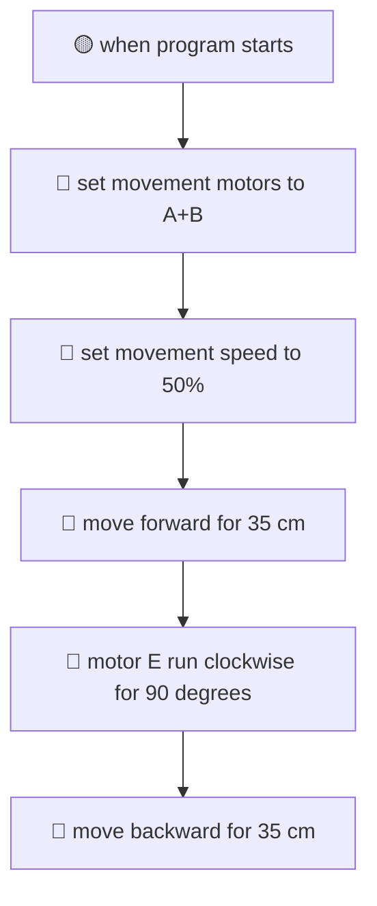

# Tutorial 2: Programming with LEGO SPIKE Prime Word Blocks

For many FIRST LEGO League teams, the official **LEGO® SPIKE™ Prime Word Blocks** environment is the go-to programming language. Based on Google Blockly and Scratch 3.0, Word Blocks provides an intuitive, color-coded drag-and-drop interface that makes autonomous robotics accessible to students of all skill levels.

In this tutorial, you will explore the simulator's built-in **Word Blocks Studio**, build a multi-step autonomous drive and attachment mission, learn how to manage and zoom your block canvas, and export/import competition files.

---

## 🎯 Learning Objectives

By the end of this tutorial, you will be able to:

1. Open and arrange the Word Blocks Studio in both the **Collapsible Side Drawer** and the **Full-Screen Popout Modal**.
2. Navigate the **3-Column SPIKE Workspace** (Category Sidebar, Block Palette Drawer, and Dotted Canvas).
3. Assemble a complete 6-block autonomous mission controlling both drive motors and an auxiliary attachment motor.
4. Pan, zoom, and organize multi-step block stacks on the canvas.
5. Save your work with built-in **Autosave**, export projects as `.zip` bundles, and import official LEGO `.llsp3` project files.
6. Solve **Hands-On Challenge 2** by creating a simulated Coral Reef mission run.

---

## 🖥️ Step 1: Opening the Word Blocks Studio (Drawer vs. Popout Modal)

`fll-sim` offers two flexible ways to work with Word Blocks:

### 1. The Collapsible Side Drawer View
Click the **💻 Code** button on the far-left Activity Bar. The side drawer expands on the left, displaying your block stack right alongside the 3D competition table:


* **Best For**: Rapid tweaking and quick testing where you want to watch the robot drive in the 3D viewport while seeing the active block highlights.

### 2. The Full-Screen Popout Modal
When building complex, multi-step programs with dozens of blocks, you need maximum screen real estate. Click either:
* The **💻 Code Editor** button in the top navigation bar, OR
* The **⤢ Pop Out** button located in the drawer header.


* **Window Pinning Controls** (Top Right of Modal):
    * **`⛶` Maximize (Full-Screen)**: Expands the Studio across your entire monitor.
    * **`◧` Pin Left**: Snaps the block canvas to the left half of the screen, leaving the right half open for the 3D field.
    * **`◨` Pin Right**: Snaps the block canvas to the right half of the screen.
    * **`🗗` Float**: Turns the editor into a draggable, resizable floating window.
    * **`⤓ Dock Back`**: Collapses the modal back into the side drawer.

---

## 🧩 Step 2: Navigating the 3-Column SPIKE Workspace

The simulator faithfully replicates the 3-column architecture of the official LEGO SPIKE App:

```
┌─────────────────┬──────────────────────┬─────────────────────────────────────┐
│ 1. CATEGORY BAR │  2. PALETTE DRAWER   │          3. CANVAS VIEWPORT         │
│                 │                      │                                     │
│  ● All          │  [When Program Starts]  [when program starts]               │
│  ● Motors       │  [Move Forward 10cm] │       │                             │
│  ● Movement     │  [Set Speed to 50%]  │       ▼                             │
│  ● Events       │  [Motor E Run 90°]   │  [set movement motors to A+B]       │
│  ● Control      │  ...                 │       │                             │
│  ● Sensors      │                      │       ▼                             │
│  ● Operators    │                      │  [move forward for 35 cm]           │
└─────────────────┴──────────────────────┴─────────────────────────────────────┘
```

### 1. Category Sidebar (Far Left)
Color-coded icons that filter available blocks by functional robotics subsystem:
* **Motors (Blue)**: Single-motor commands for attachments on Ports C, D, E, and F (run for degrees, seconds, speed).
* **Movement (Pink)**: Synchronized differential drive base commands for Ports A+B (move forward, backward, tank turns, steering).
* **Events (Yellow)**: Program initiation triggers (`when program starts`, broadcast messages).
* **Control (Orange)**: Execution flow (`wait 1 seconds`, `repeat 10`, `forever`, `if...then...else`).
* **Sensors (Cyan)**: Optical color sensor, ultrasonic distance, and Hub IMU gyro readings.
* **Operators (Green)**: Mathematical math blocks ($+$, $-$, $\times$, $\div$, comparisons, random numbers).

### 2. Block Palette Drawer (Center)
Displays the library of available blocks for the selected category. You can drag any block from this drawer directly into your canvas.

### 3. Canvas Viewport (Right)
An infinite dotted-grid workspace where you assemble your code. Blocks automatically snap together with an audible and visual click when brought close to a compatible connector notch.

---

## 🚀 Step 3: Creating a Precision Drive & Attachment Mission

Let's build a competition mission that drives our robot forward out of the Red Arc, activates an attachment mechanism to interact with a mission model, and then backs up safely to Home Base.



### Assemble the 6 Core Blocks:

1. **`when program starts` (Events - Yellow)**:
    * Every FLL program begins with this hat block. It acts as the execution entry point when you press `▶ RUN`.
2. **`set movement motors to [A + B]` (Movement - Pink)**:
    * Tells the virtual SPIKE Hub which motor ports drive the left and right wheels. By default, the Advanced Driving Base uses **Port A** for the left wheel and **Port B** for the right wheel.
3. **`set movement speed to [50] %` (Movement - Pink)**:
    * Configures the cruising velocity. Running at $50\%$ provides the optimal balance of speed and mechanical stability on the competition mat.
4. **`move [forward] for [35] [cm]` (Movement - Pink)**:
    * The simulator's kinematic model calculates the exact rotational degrees needed for the 56 mm rubber wheels to travel 35 cm:
      $$\text{Rotations} = \frac{\text{Distance}}{\pi \times \text{Diameter}} = \frac{35\,\text{cm}}{\pi \times 5.6\,\text{cm}} \approx 1.989\,\text{rotations} \approx 716^\circ$$
5. **`motor [E] run [clockwise] for [90] [degrees]` (Motors - Blue)**:
    * Activates the auxiliary motor connected to **Port E**. This turns your attachment lever by exactly a quarter rotation ($90^\circ$), lifting or pressing the mission model.
6. **`move [backward] for [35] [cm]` (Movement - Pink)**:
    * Reverses the drive motors, bringing your robot back behind the Home Arc perimeter line.

### Running the Mission:
1. Click **▶ RUN** at the bottom of the editor (or in the top bar).
2. Watch the 3D viewport:
    * The robot accelerates smoothly out of the Red Arc.
    * At 35 cm, the drive motors brake.
    * Motor E rotates its output shaft by $90^\circ$.
    * The robot reverses 35 cm directly back to the starting line!

---

## 🔍 Step 4: Zooming and Organizing Canvas Blocks

As your team develops multiple runs for different missions, your canvas will grow. `fll-sim` includes full pan and zoom navigation:

* **Mouse Wheel**: Scroll up to zoom in, scroll down to zoom out.
* **Canvas Panning**: Click and drag any empty area of the dotted canvas background to pan smoothly across your workspace.
* **Floating Zoom Controls** (Bottom-Right of Canvas):
    * **`➕` Button**: Zooms in by $15\%$.
    * **`➖` Button**: Zooms out by $15\%$.
    * **`↺ 100%` Button**: Instantly resets magnification to $100\%$ and centers the active block stack.
    * **Zoom Badge**: Displays current magnification ($50\% \text{ to } 200\%$).

!!! tip "Judging Tip: Clean Canvas & Code Comments"
    FLL Robot Design judges love clean code! Keep separate mission runs organized in clear columns across your canvas. Right-click any block to add an explanatory comment (e.g., *"Mission 1: Coral Reef push and lever release"*). Judges will award high marks for well-documented software engineering!

---

## 💾 Step 5: Autosave, Exporting Scripts, and Importing `.llsp3` Files

Never lose team progress! The simulator includes a multi-tier persistence engine:

### 1. Instant Autosave
Notice the **`💾 Saved`** green status indicator in the editor toolbar. Every change you make—dragging a block, editing a parameter value, or creating a new tab—is immediately saved to your browser's persistent local storage. If you accidentally close your browser tab, your complete program will be restored the moment you return!

### 2. Exporting Single Scripts and ZIP Archives
* **`💾 Export`**: Downloads the currently active script as a standalone `.py` Python file.
* **`📦 Export Zip`**: Bundles **all** active scripts, word blocks configurations, and custom missions into a single timestamped `.zip` archive.
    * *Coach Recommended Workflow*: Have your team's software lead click `📦 Export Zip` at the end of every team meeting and upload the archive to Google Drive or GitHub.

### 3. Importing Existing Team Files
Click **`📥 Import Code`** to upload:
* Official LEGO SPIKE App v3 projects (**`.llsp3`**)
* Legacy SPIKE App v2 projects (**`.llsp`**)
* Scratch 3.0 projects (**`.sb3`**)
* Standard Python scripts (**`.py`**)

The simulator's built-in `spike-scratch-importer` parses the JSON AST inside the `.llsp3` ZIP container and instantly recreates the visual blocks on your canvas!

---

## 🏆 Hands-On Challenge 2: The Coral Reef Lift & Return Mission

Put your Word Blocks skills into practice with a realistic season challenge!

### Challenge Prompt:
> **Scenario**: The robot must leave the Red Launch Arc, navigate $42.0\,\text{cm}$ across the field, stop in front of the coral nursery, lower an attachment arm on **Port E** by $120^\circ$ to hook the coral branch, wait $0.5$ seconds for physics stabilization, lift the coral branch by $120^\circ$ counter-clockwise, and finally drive backward $42.0\,\text{cm}$ into Home Base.
> 
> **Requirements**:
> 1. Set movement speed to $45\%$.
> 2. Ensure motor E stops with brake mode enabled.
> 3. Use an orange `wait` block between lowering and lifting to allow physical contact settling.
> 4. Verify in the Telemetry Dock that the robot returns within $0.5\,\text{cm}$ of the start line.

---

### Challenge 2 Solution

=== "Word Blocks Stack"
    ```
    [when program starts]
    [set movement motors to A+B]
    [set movement speed to 45%]
    [move forward for 42 cm]
    [motor E set stop action to [hold]]
    [motor E run clockwise for 120 degrees]
    [wait 0.5 seconds]
    [motor E run counterclockwise for 120 degrees]
    [move backward for 42 cm]
    [stop [all motors]]
    ```

=== "Generated SPIKE Python Equivalent"
    ```python
    from spike import MotorPair, Motor
    from spike.control import wait_for_seconds

    # Initialize Drive Base and Attachment Motor E
    motors = MotorPair('A', 'B')
    motor_e = Motor('E')

    # Configure cruising speed
    motors.set_default_speed(45)

    print("Step 1: Driving 42 cm to Coral Reef...")
    motors.move(42, 'cm')

    print("Step 2: Lowering attachment arm 120 degrees...")
    motor_e.run_for_degrees(120, speed=30)

    # Allow Rapier 3D physics settling
    wait_for_seconds(0.5)

    print("Step 3: Lifting coral branch 120 degrees...")
    motor_e.run_for_degrees(-120, speed=30)

    print("Step 4: Returning to Home Base...")
    motors.move(-42, 'cm')

    print("Mission Complete!")
    ```

### Why Include a 0.5-Second Wait Block?
In physical robotics, momentum and elastic rebound occur when Technic beams impact plastic mission elements. Pausing for $0.5$ seconds lets vibrations dissipate and allows the attachment teeth to seat securely before reversing direction. This simple habit prevents dropped mission elements on the competition field!

---

## ⏭️ Next Step

Ready to level up to text-based coding? Proceed to **[Tutorial 3: Authentic SPIKE Python Programming & Autonomous Navigation →](03_python_programming.md)** to learn gyro pivot turns, proportional line tracking, and sensor squaring algorithms!
