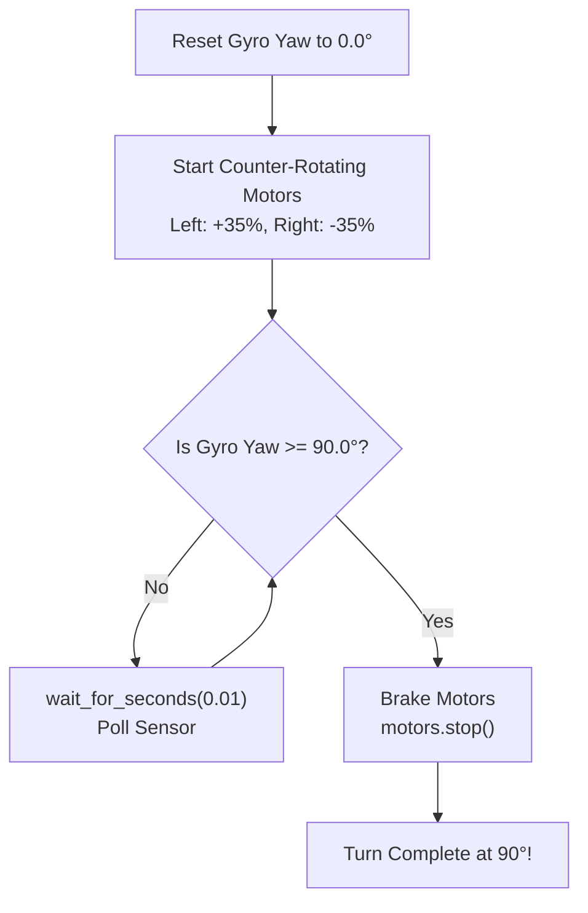
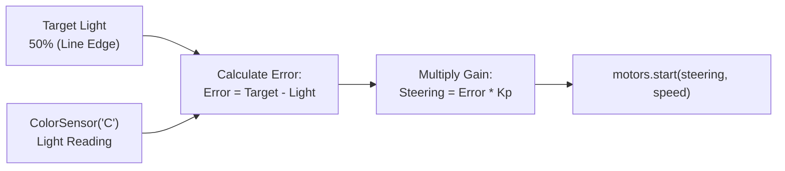
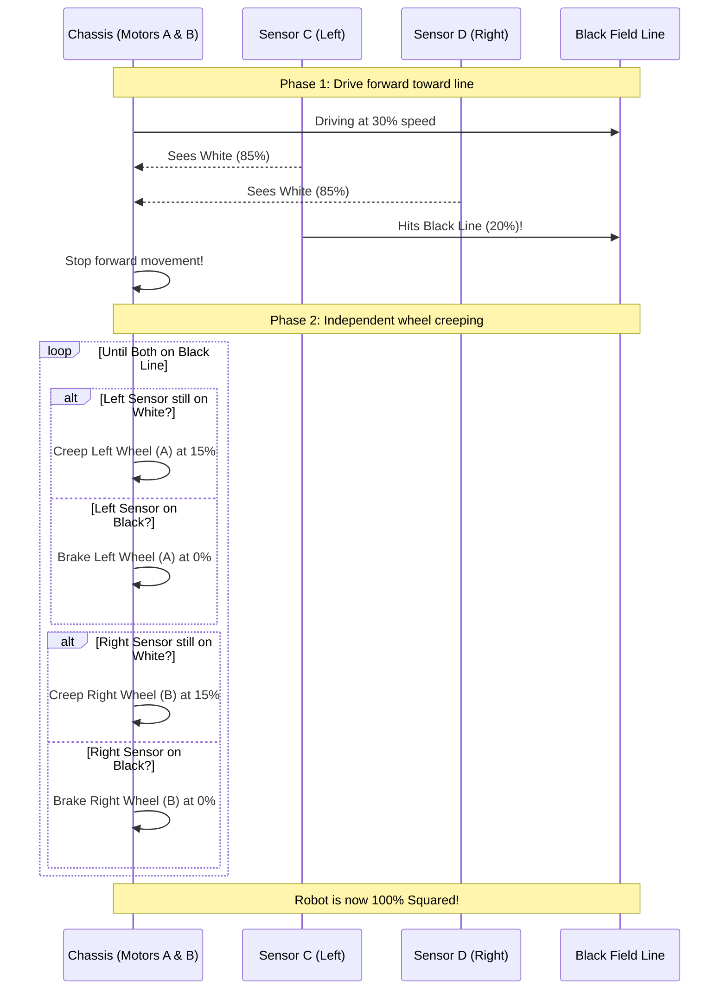
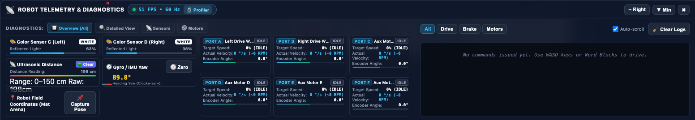

# Tutorial 3: Authentic SPIKE Python Programming & Autonomous Navigation

While visual Word Blocks are fantastic for getting started, text-based **Python** provides the ultimate speed, algorithmic precision, and mathematical control for high-scoring *FIRST*® LEGO® League competition teams.

In this tutorial, you will write authentic Python scripts using the official `spike` library syntax, implement closed-loop **Gyro IMU pivot turns**, design a smooth **Proportional (P-Controller) Line Follower**, build an error-eliminating **Dual-Sensor Line Squaring routine**, and debug issues using the simulator's **Live Event Log Stream**.

---

## 🎯 Learning Objectives

By the end of this tutorial, you will be able to:

1. Import and instantiate `PrimeHub`, `MotorPair`, `ColorSensor`, and control timers from the `spike` library.
2. Replace inconsistent dead-reckoning wheel turns with closed-loop **Gyro 90° Precision Tank Turns**.
3. Understand the mathematics of a **Proportional (P) Controller** to track the boundary of field lines without oscillating.
4. Program a **Dual-Sensor Line Squaring algorithm** that realigns the robot's heading to zero-drift precision.
5. Inspect the **Live Command & Event Logs stream** to diagnose motor latency, sensor polling rates, and physics collisions.
6. Solve **Hands-On Challenge 3** by programming a multi-stage autonomous navigation routine.

---

## 🐍 Step 1: Writing Python for the Virtual SPIKE Prime Hub

In `fll-sim`, the Python environment runs directly in your browser using an asynchronous Python-to-TypeScript runtime that faithfully implements the official LEGO SPIKE Prime Python API.

To switch to Python mode:
1. Open the Code Editor (either in the side drawer or popout modal).
2. Click the **💻 Python** toggle button in the header bar.
3. You now have a full-featured code editor with syntax highlighting and auto-indentation.

### The Essential SPIKE Library Imports

Every competition script typically begins with these core imports:

```python
from spike import PrimeHub, MotorPair, ColorSensor, Motor
from spike.control import wait_for_seconds

# Initialize the Hub (provides access to the 6-axis Gyro IMU)
hub = PrimeHub()

# Initialize differential drive motors on Ports A and B
motors = MotorPair('A', 'B')

# Initialize optical color sensors on Ports C (Left) and D (Right)
color_left = ColorSensor('C')
color_right = ColorSensor('D')
```

!!! important "Crucial Concept: `wait_for_seconds()` in Simulation"
    In physical MicroPython on the SPIKE Hub, a `time.sleep()` halts the processor core. In a browser simulation, however, calling blocking sleeps freezes the WebGL render loop!
    
    Always use `from spike.control import wait_for_seconds`. The simulator's `wait_for_seconds()` yields execution cooperatively back to the browser, allowing the Rapier 3D physics engine and Three.js canvas to step forward at a rock-solid 60 FPS while your loop runs.

---

## 🧭 Step 2: Gyro 90-Degree Precision Tank Turn

### Why Do "Turn for Degrees" Moves Fail in FLL?
Many rookie teams program turns by running one wheel forward for $180^\circ$ and the other backward for $180^\circ$. While this works on clean paper, it constantly drifts on competition mats due to:
* Dust and static friction differences on vinyl surfaces.
* Varying battery voltage (a low battery turns slower than a fresh battery).
* Center-of-mass shifts from heavy attachment arms.

The professional solution is **closed-loop feedback** using the Hub's internal 6-axis Gyroscope!



### Gyro Turn Implementation:

```python
from spike import PrimeHub, MotorPair
from spike.control import wait_for_seconds

hub = PrimeHub()
motors = MotorPair('A', 'B')

# 1. Reset Gyro Yaw heading to zero
hub.motion_sensor.reset_yaw_angle()
wait_for_seconds(0.2)  # Brief pause for IMU baseline settling

print("Starting Gyro 90° Pivot Turn...")

# 2. Start a tank pivot (Left wheel forward, Right wheel backward)
motors.start_tank(35, -35)

# 3. Closed-loop monitoring: keep turning until 90 degrees reached
while hub.motion_sensor.get_yaw_angle() < 90:
    wait_for_seconds(0.01)

# 4. Instant active braking
motors.stop()

final_yaw = hub.motion_sensor.get_yaw_angle()
print(f"Turn successfully locked in at Yaw: {final_yaw:.1f}°")
```

### Key Parameters:
* **`start_tank(35, -35)`**: Turning at $35\%$ speed ensures the robot doesn't overshoot $90^\circ$ due to rotational inertia.
* **`get_yaw_angle()`**: Returns the instantaneous angular orientation relative to the last zero point.
* **`wait_for_seconds(0.01)`**: High-frequency 100 Hz sensor polling loop.

---

## 〰️ Step 3: Proportional Line Follower (P-Controller)

On an FLL field, black guide lines link your launch sector directly to key mission models. Simple "two-state" (bang-bang) line followers oscillate violently back and forth like a snake. 

A **Proportional (P) Controller** calculates the mathematical *error* between where the robot is and where it wants to be, smoothly adjusting steering proportionally to that error.



### The Mathematics:
1. **Target**: We follow the *edge* where white vinyl ($90\%$ light) meets black line ($20\%$ light). The target is the midpoint:
   $$\text{Target} = 50\%$$
2. **Error**: The difference between our target and what Color Sensor C currently sees:
   $$\text{Error} = \text{Target} - \text{Reflected Light}$$
3. **Steering Correction**:
   $$\text{Steering} = \text{Error} \times K_p$$
   where $K_p$ is the **Proportional Gain** (typically $0.7 \text{ to } 1.0$).

### Proportional Line Follower Implementation:

```python
from spike import MotorPair, ColorSensor
from spike.control import wait_for_seconds

motors = MotorPair('A', 'B')
color_c = ColorSensor('C')  # Left downward optical sensor

TARGET_LIGHT = 50   # 50% reflected light = edge of black line
KP = 0.85           # Proportional tuning constant
CRUISE_SPEED = 35   # Stable driving speed

print("Engaging Proportional Line Tracking...")

# Run line follower for 250 control cycles (approx. 5 seconds)
for cycle in range(250):
    current_light = color_c.get_reflected_light()
    
    # Calculate error and steering adjustment
    error = TARGET_LIGHT - current_light
    steering = error * KP
    
    # Apply steering correction with forward velocity
    motors.start(steering=int(steering), speed=CRUISE_SPEED)
    wait_for_seconds(0.02)  # 50 Hz control loop

motors.stop()
print("Line tracking complete!")
```

!!! tip "Tuning Proportional Gain ($K_p$)"
    * If $K_p$ is **too low** ($< 0.4$): The robot responds too sluggishly and drifts off sharp line curves.
    * If $K_p$ is **too high** ($> 1.5$): The robot jerks and oscillates violently.
    * For the Advanced Driving Base in `fll-sim`, a $K_p$ between **$0.75$ and $0.90$** provides glass-smooth tracking!

---

## 📐 Step 4: Dual-Sensor Line Squaring Algorithm

In high-level FLL competition, teams cannot rely on odometry alone across a long 2.5-minute run. Small tire slips accumulate into large positional errors.

The **Dual-Sensor Line Squaring** routine is the gold standard for resetting positional and angular error: as the robot approaches a black perpendicular line, each wheel moves independently until both downward sensors detect black. The robot is then mathematically guaranteed to be square ($90.0^\circ$) to the line!



### Line Squaring Implementation:

```python
from spike import MotorPair, ColorSensor
from spike.control import wait_for_seconds

motors = MotorPair('A', 'B')
sensor_c = ColorSensor('C')  # Left sensor
sensor_d = ColorSensor('D')  # Right sensor

BLACK_THRESHOLD = 30  # Light < 30% indicates black tape

print("Phase 1: Driving toward black line...")
motors.start(steering=0, speed=30)

# Drive forward until EITHER sensor detects the line
while sensor_c.get_reflected_light() > BLACK_THRESHOLD and sensor_d.get_reflected_light() > BLACK_THRESHOLD:
    wait_for_seconds(0.01)

motors.stop()
print("Line detected! Phase 2: Squaring heading...")

# Align both wheels until BOTH sensors rest precisely on black
for step in range(120):
    left_light = sensor_c.get_reflected_light()
    right_light = sensor_d.get_reflected_light()

    # Move each wheel only if its sensor hasn't reached black yet
    left_speed = 15 if left_light > BLACK_THRESHOLD else 0
    right_speed = 15 if right_light > BLACK_THRESHOLD else 0

    # If both wheels have reached the black line, we are perfectly square!
    if left_speed == 0 and right_speed == 0:
        print("Both sensors locked on black line!")
        break

    motors.start_tank(left_speed, right_speed)
    wait_for_seconds(0.02)

motors.stop()
print("Robot perfectly squared to field line!")
```

---

## 🔍 Step 5: Debugging with the Command & Event Logs Stream

When an autonomous routine doesn't behave as expected, don't guess—check the **Live Telemetry & Event Stream**!

Click **📡 Telemetry** in the top bar to inspect the log stream in the right column:



### What the Event Stream Displays:
* **`[CMD: MOTOR_START_TANK]`**: Confirms the exact left and right speeds transmitted to the Rapier physics joints.
* **`[EVENT: GYRO_POLL]`**: Real-time yaw degree readings with timestamps.
* **`[EVENT: SENSOR_COLOR]`**: Reflected light percentage snapshots when color thresholds trigger.
* **`[BRAKE: HOLD]`**: Verifies that active motor braking engaged immediately without coasting.

You can filter entries using the filter chips:
* **All**: Full system log.
* **Drive**: Differential steering and forward moves.
* **Brake**: Stopping events and motor hold commands.
* **Motors**: Encoder readouts and auxiliary attachment movement.

---

## 🏆 Hands-On Challenge 3: Turn, Track & Square Sequence

Combine all three autonomous techniques into a single, tournament-grade navigation routine!

### Challenge Prompt:
> **Mission Scenario**: 
> 1. Start inside the Red Launch Arc facing East ($90^\circ$).
> 2. Execute a precision Gyro Pivot Turn $45^\circ$ to the left to align with the diagonal field line (Target Yaw = $45.0^\circ$).
> 3. Drive forward using the Proportional Line Follower for $3.0$ seconds along the line edge.
> 4. Disengage line following and perform a Dual-Sensor Line Squaring maneuver against the cross-line.
> 5. Print a final diagnostic report confirming that both sensors read black and reporting the calibrated Gyro heading.

---

### Challenge 3 Solution

```python
from spike import PrimeHub, MotorPair, ColorSensor
from spike.control import wait_for_seconds

# 1. Hardware Initialization
hub = PrimeHub()
motors = MotorPair('A', 'B')
color_left = ColorSensor('C')
color_right = ColorSensor('D')

# Calibrate Gyro
hub.motion_sensor.reset_yaw_angle()
wait_for_seconds(0.2)
print("=== MISSION RUN: TURN, TRACK & SQUARE ===")

# STEP 1: Precision Gyro Turn to 45 degrees
print("Step 1: Pivot turning to 45 degrees...")
motors.start_tank(-30, 30)  # Counter-clockwise pivot
while hub.motion_sensor.get_yaw_angle() > -45:
    wait_for_seconds(0.01)
motors.stop()
print(f"Turn complete. Current Yaw: {hub.motion_sensor.get_yaw_angle():.1f}°")

# STEP 2: Proportional Line Follower on Color Sensor C
print("Step 2: Tracking line for 3 seconds...")
TARGET_LIGHT = 50
KP = 0.8
CRUISE_SPEED = 35

for step in range(150):  # 150 cycles * 0.02s = 3.0 seconds
    light = color_left.get_reflected_light()
    error = TARGET_LIGHT - light
    steering = int(error * KP)
    motors.start(steering, CRUISE_SPEED)
    wait_for_seconds(0.02)

motors.stop()
print("Step 2 complete.")

# STEP 3: Dual-Sensor Line Squaring
print("Step 3: Squaring against cross-line...")
motors.start(0, 25)
while color_left.get_reflected_light() > 30 and color_right.get_reflected_light() > 30:
    wait_for_seconds(0.01)
motors.stop()

# Fine adjustment loop
for i in range(100):
    l_light = color_left.get_reflected_light()
    r_light = color_right.get_reflected_light()
    
    l_spd = 12 if l_light > 30 else 0
    r_spd = 12 if r_light > 30 else 0
    
    if l_spd == 0 and r_spd == 0:
        break
        
    motors.start_tank(l_spd, r_spd)
    wait_for_seconds(0.02)

motors.stop()

# STEP 4: Final Telemetry Verification
print("=== SEQUENCE COMPLETE ===")
print(f"Left Sensor (Port C): {color_left.get_reflected_light()}% [Black: {color_left.get_color()}]")
print(f"Right Sensor (Port D): {color_right.get_reflected_light()}% [Black: {color_right.get_color()}]")
print(f"Final Calibrated Yaw: {hub.motion_sensor.get_yaw_angle():.1f}°")
print("Robot is ready for attachment trigger!")
```

---

## ⏭️ Next Step

Now that your autonomous navigation algorithms are tournament-ready, proceed to **[Tutorial 4: Robot Architecture, Hardware Port Mapping & Calibration →](04_robot_design_and_ports.md)** to configure custom robot chassis, remap hardware ports, and test attachments in the stationary Dyno Jig!
