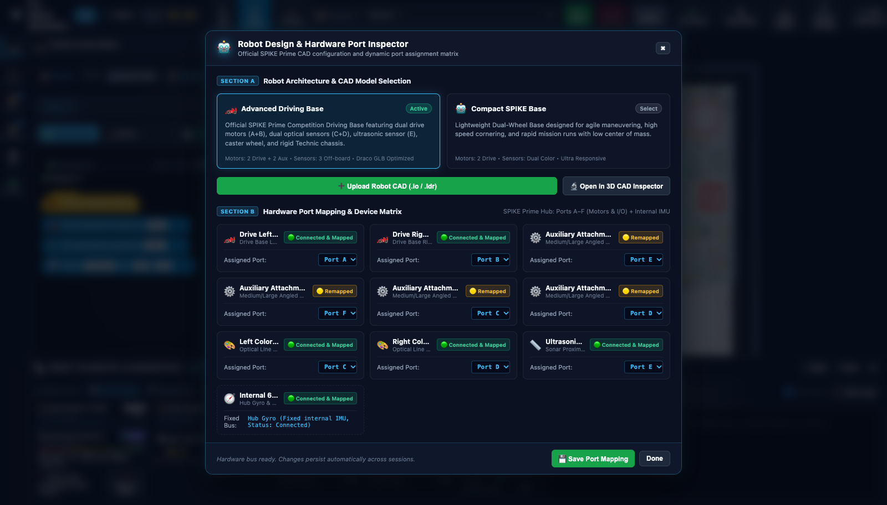
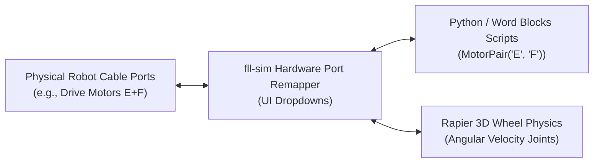

# Tutorial 4: Robot Architecture, Hardware Port Mapping & Calibration

In FIRST LEGO League, no two team robots are built identically. Your team might build the official WRO/FLL **DroidBot-E**, design a nimble **Compact SPIKE Base**, or place your drive motors on Ports E and F instead of Ports A and B.

To make the simulator a true **Digital Twin** of your physical robot, `fll-sim` includes a dynamic **Robot Design & Hardware Port Inspector**. In this tutorial, you will explore built-in chassis presets, remap hardware ports to mirror your real-world robot, test mechanisms safely in **Dyno Jig Mode**, and master encoder and gyro calibration.

---

## 🎯 Learning Objectives

By the end of this tutorial, you will be able to:

1. Compare the mechanical kinematics of the **Advanced Driving Base (DroidBot-E)** and the **Compact SPIKE Base**.
2. Navigate the **Hardware Device Matrix** for drive motors, auxiliary attachments, optical sensors, sonar, and the internal IMU.
3. Dynamically remap Hub Ports A through F to match your physical team robot without changing your code.
4. Engage **Dyno Jig Mode** to benchmark and test attachment mechanisms while the chassis remains anchored stationary.
5. Zero motor encoders and calibrate Gyro IMU heading for reproducible competition runs.
6. Complete **Hands-On Challenge 4** by configuring a non-standard port layout and verifying an attachment cycle in Dyno mode.

---

## 🏎️ Step 1: Exploring Robot Presets (Advanced Driving Base vs. Compact Base)

To open the hardware inspector, click **🤖 Robot Design** in the top navigation bar:



Under **SECTION A: Robot Architecture & CAD Model Selection**, you will see two official competition chassis presets:

### 1. Advanced Driving Base (DroidBot-E)
* **Design Background**: Based on the world-renowned DroidBot-E / LEGO Education competition reference architecture.
* **Chassis Specifications**:
    * **Track Width ($W$)**: $128\,\text{mm}$ (16 Technic studs between left and right wheel centers).
    * **Wheels**: $56\,\text{mm} \times 26\,\text{mm}$ balloon rubber tires (Circumference $\approx 17.59\,\text{cm}$).
    * **Rear Caster**: Steel ball caster housing with ultra-low rolling friction ($\mu = 0.005$).
    * **Sensors**: Dual downward-facing Color Sensors (Ports C & D) spaced 48 mm apart, plus forward Ultrasonic Sonar (Port E).
    * **Total Mass**: $475\,\text{g}$ with a realistic low center of mass ($Y = 32\,\text{mm}$ above the table).
* **Best For**: Multi-mission runs requiring dual-line squaring, push attachments, and heavy payload stability.

### 2. Compact SPIKE Base
* **Design Background**: Minimalist, high-agility differential drive chassis.
* **Chassis Specifications**:
    * **Track Width ($W$)**: $112\,\text{mm}$ (14 Technic studs).
    * **Wheels**: $56\,\text{mm}$ slim rubber tires.
    * **Mass**: $340\,\text{g}$ (nearly $30\%$ lighter than the Advanced base).
* **Best For**: High-speed sprint missions, agile zero-radius spin turns, and tight navigation between crowded mission models.

To switch active robots, click the preset card. The simulator's 3D engine immediately hot-swaps the kinematic physics model and visual mesh on the field!

---

## 🔌 Step 2: The Hardware Device Matrix

The SPIKE Prime Hub features six multi-purpose hardware ports labeled **A, B, C, D, E, and F**, plus an internal 6-axis Inertial Measurement Unit (IMU).

In **SECTION B: Hardware Port Mapping & Device Matrix**, every connected device is displayed with its functional role, current port assignment, and connection status:

| Device Component | Default Port | Device Category | Physical Hardware Equivalent |
|---|:---:|---|---|
| **Drive Left Wheel** | **Port A** | Drive Base Differential Motor | Technic Medium Angular Motor (`45603`) |
| **Drive Right Wheel** | **Port B** | Drive Base Differential Motor | Technic Medium Angular Motor (`45603`) |
| **Left Color Sensor** | **Port C** | Downward Optical Tracker | SPIKE Color Sensor (`45605`) |
| **Right Color Sensor** | **Port D** | Downward Optical Tracker | SPIKE Color Sensor (`45605`) |
| **Auxiliary Attachment 1** | **Port E** | Motorized Arm / Mechanism | Technic Large Angular Motor (`45602`) |
| **Auxiliary Attachment 2** | **Port F** | Motorized Arm / Mechanism | Technic Medium Angular Motor (`45603`) |
| **Ultrasonic Distance** | *Configurable* | Sonar Proximity Detector | SPIKE Ultrasonic Sensor (`45604`) |
| **Internal 6-Axis IMU** | **Fixed Bus** | Hub Gyroscope & Accelerometer | Built-in Hub Motion Sensor |

Each device displays a **`🟢 Connected & Mapped`** badge confirming that the Rapier 3D joint controller is active.

---

## 🔄 Step 3: Remapping Ports to Match Your Team's Robot

### The Problem in Real FLL Practice:
Your team built a custom robot. Because of cable routing constraints, the builders plugged:
* Drive motors into **Ports E & F** (instead of A & B).
* Attachment motors into **Ports A & B**.
* Color sensors into **Ports C & D**.

In many simulators, you would have to rewrite all your code. In `fll-sim`, you simply remap the virtual hardware!

### How to Remap Ports:
1. In the **Robot Design & Hardware Port Inspector**, locate the component card you want to adjust (e.g., **Drive Left Wheel**).
2. Open the **Assigned Port** dropdown and select the new port letter (e.g., change `Port A` to `Port E`).
3. Repeat for other components until your virtual setup matches your physical robot.
4. Click the blue **💾 Save Port Mapping** button in the modal footer.



!!! success "Automatic Cross-Session Persistence"
    When you click **💾 Save Port Mapping**, your configuration is saved to the browser's persistent database. You can refresh your browser, close the tab, or restart your computer, and your team's hardware layout will remain intact!

---

## 🔒 Step 4: Dyno Jig Mode (Stationary Mechanism Testing)

In physical robotics engineering, a **Dynamometer (Dyno)** or test bench anchors a vehicle stationary while its powertrain, transmissions, and mechanisms are tested at full throttle.

In `fll-sim`, **Dyno Jig Mode** anchors the robot chassis to the mat with a rigid physics pin, while allowing all drive wheels, motors, and attachment arms to spin freely under full simulated power!

```
┌─────────────────────────────────────────────────────────────┐
│ 🔒 DYNO JIG ACTIVE: Chassis Locked | Actuators Live         │
│                                                             │
│         [Drive Wheels Spin]       [Attachment Arms Sweep]   │
│                 ↺                           ⟳               │
│               ┌───┐                       ┌───┐             │
│               │ A │                       │ E │             │
│            ┌──┴───┴───────────────────────┴───┴──┐          │
│            │   ⚓ ANCHORED CHASSIS (X, Z Fixed)   │          │
│            └─────────────────────────────────────┘          │
└─────────────────────────────────────────────────────────────┘
```

### Why Use Dyno Jig Mode?
1. **Attachment Range of Motion**: Verify that your motorized arm rotates exactly $90^\circ$ or $180^\circ$ without having the robot drive across the field.
2. **Gear Backlash & Timing**: Measure the real time (in milliseconds) required for a rack-and-pinion attachment to extend and retract.
3. **Desk Testing Without Field Space**: Test your Python logic while keeping the robot in the exact same spot on the virtual table.

### How to Activate Dyno Jig:
1. Open the **⚙️ Field** drawer on the left activity bar.
2. Under **Sandbox Workbench Tools**, click **🔒 Robot Dyno: OFF**.
3. The button label changes to **🟢 Robot Dyno: ACTIVE** and a status banner appears.
4. Run your code! Watch the motors turn in the Telemetry Dock while the coordinates `(X, Z)` remain perfectly stationary.
5. Click the button again to release the anchor when you are ready to test driving.

---

## 🧭 Step 5: Zeroing Encoders and Calibrating Gyro IMU Heading

To guarantee precision across multiple runs, your robot must establish clean baselines before launching.

### 1. Zeroing Wheel Motor Encoders
Technic motors measure their rotation relative to an internal optical encoder. As wheels spin, encoder degrees accumulate ($360^\circ, 720^\circ, 1080^\circ \dots$).
* **In Telemetry Dock**: Open **⚙️ Motors** and click **↺ Zero Encoders**. All motor angles reset to $0^\circ$.
* **In Python Code**:
  ```python
  from spike import Motor
  motor_a = Motor('A')
  motor_a.set_degrees_counted(0)
  ```

### 2. Calibrating Gyro IMU Heading
When the robot spawns, the Gyro yaw is aligned with the table coordinates. However, after making multiple complex turns, you may want to redefine the robot's current heading as $0.0^\circ$:
* **In Telemetry Dock**: Under the **🧭 Gyro / IMU Yaw** card, click the **🧭 Zero** button. The compass needle snaps to North ($0^\circ$).
* **In Python Code**:
  ```python
  from spike import PrimeHub
  hub = PrimeHub()
  hub.motion_sensor.reset_yaw_angle()
  ```

---

## 🏆 Hands-On Challenge 4: Hardware Remapping & Dyno Attachment Test

### Challenge Prompt:
> **Scenario**: Your team's builder moved the robot's drive motors to **Ports C and D**, and mounted a dual-geared lifting fork on **Port A**. 
> 
> **Requirements**:
> 1. Open the **Robot Design & Hardware Port Inspector** and remap:
>    * Drive Left Wheel $\to$ **Port C**
>    * Drive Right Wheel $\to$ **Port D**
>    * Auxiliary Attachment 1 $\to$ **Port A**
> 2. Save your port mapping.
> 3. Engage **Dyno Jig Mode**.
> 4. Write a Python test script that:
>    * Drives the new wheels (Ports C & D) forward for 3 rotations to verify mapping.
>    * Cycles the attachment fork on Port A: sweeps $+90^\circ$ clockwise, pauses $1.0\,\text{s}$, then sweeps $-90^\circ$ counter-clockwise.
> 5. Confirm in the Telemetry Dock that:
>    * Robot coordinates `(X, Z)` do not move (Dyno locked).
>    * Wheel encoders on C & D show $\approx 1080^\circ$ of rotation.
>    * Attachment motor on A shows exactly $0^\circ$ net rotation after completing the cycle.

---

### Challenge 4 Solution

=== "Python Test Script (`dyno_hardware_test.py`)"
    ```python
    from spike import MotorPair, Motor
    from spike.control import wait_for_seconds

    print("=== CHALLENGE 4: DYNO ATTACHMENT BENCHMARK ===")

    # 1. Initialize with remapped hardware ports
    motors = MotorPair('C', 'D')  # Drive wheels remapped to C & D
    fork_motor = Motor('A')       # Attachment arm remapped to A

    # Configure speeds
    motors.set_default_speed(50)
    fork_motor.set_default_speed(40)

    # 2. Benchmark Drive Motors in Dyno Jig
    print("Testing remapped drive motors on Ports C & D (3 rotations = 1080°)...")
    motors.move(3, 'rotations')
    print("Drive motor benchmark complete.")

    # 3. Benchmark Attachment Motor on Port A
    print("Testing attachment arm on Port A: Sweeping +90°...")
    fork_motor.run_for_degrees(90)

    print("Holding position for 1.0s (inspecting gear mesh)...")
    wait_for_seconds(1.0)

    print("Returning attachment arm: Sweeping -90°...")
    fork_motor.run_for_degrees(-90)

    print("=== BENCHMARK SUCCESSFUL: HARDWARE MAPPING VERIFIED ===")
    ```

=== "Word Blocks Stack"
    ```
    [when program starts]
    [set movement motors to C+D]
    [set movement speed to 50%]
    [move forward for 3 rotations]
    [motor A set speed to 40%]
    [motor A run clockwise for 90 degrees]
    [wait 1.0 seconds]
    [motor A run counterclockwise for 90 degrees]
    [stop [all motors]]
    ```

### Engineering Notebook Takeaway:
Documenting port configurations and running stationary dyno checks is an authentic aerospace and automotive engineering practice known as **Hardware-in-the-Loop (HIL) Testing**. Mentioning this workflow during your team's FLL Robot Design judging session demonstrates professional software and hardware discipline!

---

## ⏭️ Next Step

Now that your robot architecture and hardware ports are calibrated, proceed to **[Tutorial 5: 3D CAD Model Inspector & Studio 2.0 Digital Twins →](05_cad_inspector_digital_twins.md)** to import BrickLink Studio `.io` builds, analyze topological pin clustering, and interact with season mission models!
