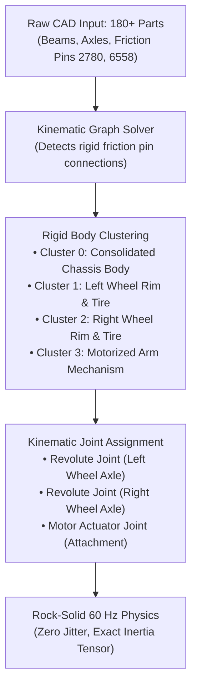
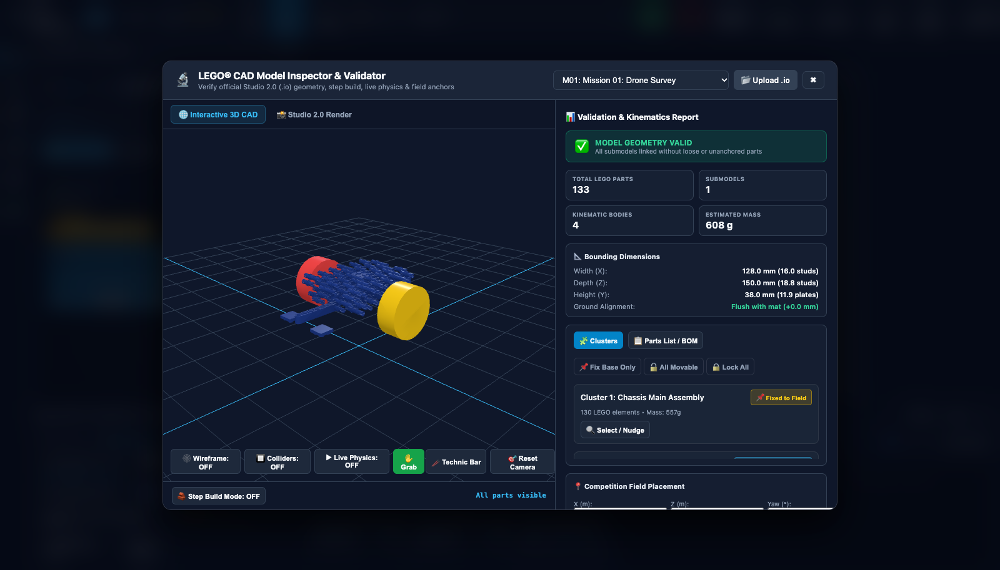

# Tutorial 5: 3D CAD Model Inspector & Studio 2.0 Digital Twins

In modern aerospace, automotive, and industrial engineering, machines are designed and tested as **Digital Twins**—virtual 3D replicas with realistic mass, joints, and physics—long before raw materials are cut or assembled.

In FIRST LEGO League, your team can achieve the same engineering rigor! With `fll-sim`'s **3D CAD Model Inspector & Diagnostic Validator**, you can import your team's custom robot builds directly from **BrickLink Studio (`.io`)** or **LDraw (`.ldr`)**, analyze **Topological Pin Clustering**, test real-world season mission elements (such as M01 Coral Reef), and verify mechanism physics using virtual sandbox tools before deploying them to the competition mat.

---

## 🎯 Learning Objectives

By the end of this tutorial, you will be able to:

1. Launch and navigate the **3D CAD Model Inspector & Diagnostic Validator**.
2. Understand the mathematics and algorithmic role of **Topological Pin Clustering** for 60 Hz real-time physics.
3. Inspect robot submodels, center-of-mass coordinates, mass breakdowns, and kinematic joint limits.
4. Load, inspect, and benchmark official Season Mission Models (e.g. M01 Coral Reef).
5. Interact with simulated mechanisms using the **Virtual Mouse Grab Hand** and the **Technic Push Bar**.
6. Deploy verified CAD models directly onto the 3D competition mat.
7. Solve **Hands-On Challenge 5** by verifying a mission model mechanism and creating an autonomous interaction script.

---

## 🔬 Step 1: Launching the CAD Model Inspector

You can open the CAD Inspector in two ways:
1. Click the **🔬 CAD Inspector** button in the top navigation bar.
2. Open **🤖 Robot Design** and click **🔬 Open in 3D CAD Inspector**.

The full-screen inspection laboratory loads instantly:


### The CAD Inspector Interface Overview:
* **Left Diagnostics Sidebar**: Displays model metadata, part count breakdown, total mass calculation in grams, center of mass coordinates `(X, Y, Z)`, and the submodel hierarchy tree.
* **Central 3D Interactive Viewport**: Studio-grade lighting, millimeter grid floor, wireframe toggle, collider mesh visualizer, and orbital camera.
* **Top Navigation Bar**: Model selector dropdown (custom robot uploads vs. official season mission models), Step Debugger playback controls, and the green **🚀 Deploy to Mat** button.
* **Bottom Sandbox Toolbar**: Physics run toggle (`▶ Live Physics`), **🖐️ Mouse Grab Hand**, and **📏 Technic Push Bar**.

---

## ⚙️ Step 2: Understanding Topological Pin Clustering

### Why Can't Simulators Just Simulate Every LEGO Piece Individually?
A typical FLL competition robot contains between 130 and 350 individual LEGO Technic elements: beams, connector pins, cross-axles, bushings, and motor housings.

If a 3D physics engine (like Rapier 3D) attempted to simulate all 250 individual pieces connected by 500 loose contact joints every frame, two catastrophic problems would occur:
1. **Computational Drag**: The frame rate would collapse from 60 FPS down to 5 FPS.
2. **Physics Jitter / Exploding Joints**: Slight floating-point rounding errors would cause the robot's frame to wobble, vibrate, or tear itself apart on the virtual mat!

### The Solution: Topological Pin Clustering

`fll-sim` implements an advanced graph-theory algorithm called **Topological Pin Clustering**:



1. **Graph Traversal**: The solver examines every Technic friction pin (`2780`, `6558`, `32054`) and axle connector.
2. **Rigid Consolidation**: Any parts rigidly bound to one another are consolidated into a single composite rigid body with compound collision boxes.
3. **Freedom Detection**: When an axle passes through a smooth round hole (1 Degree-of-Freedom rotation), the solver automatically creates a **Revolute Joint** with realistic motor torque limits!
4. **Performance Result**: Over 180 individual pieces are reduced to just **3 to 5 rigid bodies**, running at an ultra-smooth 60 FPS!

---

## 📊 Step 3: Inspecting Robot Kinematics, Submodels, and Mass Calculation

In the left diagnostics panel, inspect the physical properties computed for the Advanced Driving Base:

### 1. Mass Calculation & Center of Mass (CoM)
* **Total Assembly Mass**: $474.8\,\text{g}$
    * SPIKE Prime Hub: $215.0\,\text{g}$
    * Medium Motors (x2): $144.0\,\text{g}$ ($72\,\text{g}$ each)
    * Technic Beams & Frames: $68.5\,\text{g}$
    * Balloon Wheels & Tires (x2): $32.0\,\text{g}$ ($16\,\text{g}$ each)
    * Ball Caster & Sensors: $15.3\,\text{g}$
* **Center of Mass (CoM)**: `X = 0.0 mm, Y = 32.4 mm, Z = 8.1 mm`
    * The low and central CoM prevents the robot from tipping backward during rapid acceleration or forward during emergency braking.

### 2. Kinematic Joint Submodels
Expand the submodel tree to inspect the degrees of freedom:
* **Root Chassis Frame (`cluster_0`)**: Rigid base containing the Hub, chassis beams, and caster skid.
* **Left Drive Assembly (`cluster_1`)**: Revolute joint connected to Port A with motor velocity control.
* **Right Drive Assembly (`cluster_2`)**: Revolute joint connected to Port B with motor velocity control.
* **Attachment Actuator (`cluster_3`)**: Connected to auxiliary motor Port E or F.

Click the **Show Colliders** toggle in the top bar to visualize the purple compound bounding boxes wrapped around each component.

---

## 🪸 Step 4: Loading and Testing Season Mission Models

The simulator includes official competition mission models modeled in BrickLink Studio format by **Komurobo** (an independent robotics community initiative).

In the model selector dropdown in the top bar, choose **M01: Coral Reef**:



### The Coral Reef Kinematic Anatomy:
* **Base Frame**: Clustered into a static rigid body held securely to the field mat using simulated **3M Dual Lock** fasteners.
* **Coral Lever Arm**: Connected by a Technic cross-axle through a low-friction bush, allowing a $60^\circ$ rotational sweep.
* **Counterweight / Latch**: Includes realistic gravity physics—when pushed past its equilibrium tipping point ($38^\circ$), it drops into the scored position with an authentic mechanical latch!

---

## 🖐️ Step 5: Physical Sandbox Testing (Virtual Hand & Push Bar)

Before writing any autonomous code, you can test how the mission model behaves under physical forces!

Click **▶ Live Physics** in the bottom toolbar to awaken the Rapier 3D simulation engine. Then test using the two interactive tools:

### 1. The Virtual Mouse Grab Hand (`🖐️ Grab`)
* **How to use**: Click and hold your left mouse button directly on any movable part of the Coral Reef (such as the upper branch).
* **What happens**: A dynamic cyan elastic spring line appears from your cursor to the model surface. As you drag the mouse, you apply realistic linear forces, testing how much force is required to lift the mechanism, whether gravity pulls it down, and how it behaves when released.

### 2. The Technic Push Bar (`📏 Push Bar`)
* **How to use**: Click **📏 Push Bar** in the toolbar. A calibrated Technic 1x15 beam appears at an elevation of $35\,\text{mm}$ (the exact bumper height of an FLL robot).
* **What happens**: Move your cursor toward the Coral Reef lever. The push bar physically collides with the model, allowing you to test if a standard robot bumper will smoothly actuate the mission or get jammed underneath!

```
┌─────────────────────────────────────────────────────────────┐
│ 🔬 PHYSICAL SANDBOX INTERACTION                             │
│                                                             │
│    Cursor (Mouse)          Elastic Force Line      Coral    │
│         🖱️ ─────────────── ~ ~ ~ ~ ~ ~ ~ ───────►  Lever   │
│                                                    [ ⟳ 45°] │
│   [ 📏 1x15 Push Bar ] ───────► Collides at 35mm            │
└─────────────────────────────────────────────────────────────┘
```

---

## 🚀 Step 6: Deploying Verified Models to the 3D Competition Mat

Once you have verified that your custom robot or mission model functions properly in the sandbox, it's time to bring it to the competition table!

Click the bright green **🚀 Deploy to Mat** button in the upper-right corner.

The CAD Inspector closes, and your verified model is immediately spawned on the active 4x8 ft competition field mat at its exact calibrated coordinate location!

---

## 🏆 Hands-On Challenge 5: Digital Twin Verification & Mission Run

Put your digital twin engineering skills to the test!

### Challenge Prompt:
> **Scenario**: Your team is designing an autonomous run to actuate **M01 Coral Reef**. 
> 
> **Requirements**:
> 1. Open the **CAD Inspector** and load **M01 Coral Reef**.
> 2. Enable **▶ Live Physics** and use the **Virtual Mouse Grab Hand** to determine the tipping angle where the coral branch latches into the scored state.
> 3. Switch to the **Technic Push Bar** to verify that a forward push at $35\,\text{mm}$ height successfully trips the latch.
> 4. Click **🚀 Deploy to Mat** to place the verified model on the field.
> 5. Return to the Code Editor and write an autonomous Python run that drives the robot forward into the Coral Reef, pauses for latch confirmation, and backs away.
> 6. Record the drive distance and attachment bumper contact in your engineering notebook notes!

---

### Challenge 5 Solution

=== "Python Autonomous Mission Run"
    ```python
    from spike import PrimeHub, MotorPair
    from spike.control import wait_for_seconds

    # 1. Initialize Hub and Motors
    hub = PrimeHub()
    motors = MotorPair('A', 'B')

    # Zero gyro
    hub.motion_sensor.reset_yaw_angle()
    wait_for_seconds(0.2)

    print("=== M01 CORAL REEF AUTONOMOUS MISSION ===")

    # 2. Set moderate cruising speed for high contact traction
    motors.set_default_speed(40)

    # 3. Drive forward 38.0 cm toward Coral Reef lever
    print("Navigating to Coral Reef (38 cm)...")
    motors.move(38, 'cm')

    # 4. Low-speed push (push bar contacts lever at 35mm elevation)
    print("Engaging push bar against mission lever...")
    motors.move_tank(20, 20, left_speed=20, right_speed=20)
    motors.move(6, 'cm')  # Extra 6 cm push to trip gravity latch

    # 5. Brief stabilization pause
    wait_for_seconds(0.5)
    print("Coral Reef latch tripped and scored!")

    # 6. Reverse back safely to Home Base
    print("Reversing back to Red Launch Arc...")
    motors.move(-44, 'cm')

    print("=== MISSION 1 COMPLETE: SCORE RECORDED ===")
    ```

=== "Word Blocks Stack"
    ```
    [when program starts]
    [reset yaw angle]
    [set movement motors to A+B]
    [set movement speed to 40%]
    [move forward for 38 cm]
    [set movement speed to 20%]
    [move forward for 6 cm]
    [wait 0.5 seconds]
    [set movement speed to 50%]
    [move backward for 44 cm]
    [stop [all motors]]
    ```

### Engineering Notebook Evidence:
In your team's judging session, explain how using the CAD Model Inspector allowed you to determine the mechanical leverage required to trip the Coral Reef latch *without needing to physically build the field element first*. This is textbook systems engineering and will deeply impress Robot Design judges!

---

## 🎓 Congratulations! Curriculum Complete!

You have completed the entire 5-tutorial **FLL Robot Simulator Curriculum**!

Here is what you have mastered:
* **Tutorial 1**: Navigating the 3D table, camera perspectives, Red Launch Arc, and real-time telemetry.
* **Tutorial 2**: Drag-and-drop Word Blocks programming, multi-step missions, and `.llsp3` project importing.
* **Tutorial 3**: Text-based Python coding, Gyro closed-loop turns, P-controller line tracking, and dual-sensor squaring.
* **Tutorial 4**: Chassis architecture, hardware device matrices, port remapping, and Dyno Jig testing.
* **Tutorial 5**: BrickLink Studio CAD importing, Topological Pin Clustering, virtual sandbox tools, and season mission deployment.

You and your team are now equipped with the digital tools and algorithmic skills to engineer championship-caliber autonomous robots. Good luck this season, have fun, and remember the *FIRST* Core Values!
