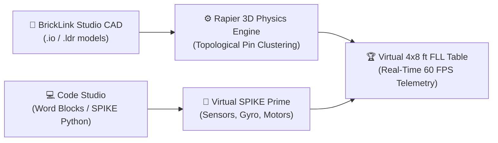
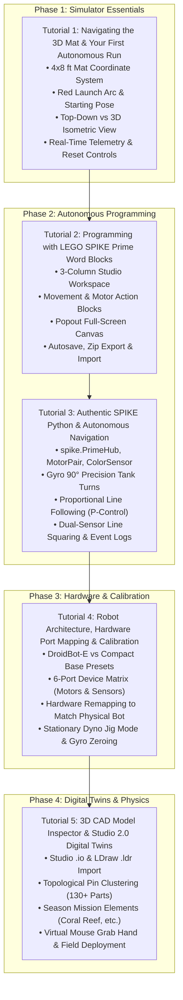

# FLL Robot Simulator: Student & Coach Tutorial Curriculum

Welcome to the **FLL Robot Simulator (`fll-sim`) Tutorial Curriculum**! Whether you are a rookie *FIRST*® LEGO® League (FLL) student writing your very first autonomous navigation script, a veteran team programmer refining a PID line follower, or a coach seeking an equitable way for every student to practice without crowding around a single physical table, this comprehensive curriculum is designed for you.

---

## 🧭 Welcome to the Virtual Competition Table

In traditional FLL robotics, teams face a familiar bottleneck: one 4x8 ft competition table, one SPIKE™ Prime robot hub, and 4 to 10 eager students waiting for their turn to test code. 

`fll-sim` solves this challenge by delivering an **open-source, 100% browser-based 3D robotics digital twin**. Powered by Three.js WebGL rendering and Rapier 3D rigid-body physics running at 60 Hz, `fll-sim` emulates the exact kinematic behavior, sensor feedback, motor friction, and mission element interactions of an authentic competition table.

!!! tip "Coach & Mentor Tip: 1-to-1 Robotics Practice"
    With `fll-sim`, every team member can iterate simultaneously on their own Chromebook, laptop, or desktop computer. Students can write programs at home, verify kinematic attachments in the 3D CAD inspector, and arrive at team meetings with thoroughly tested autonomous runs ready to transfer to the physical robot!

---

## 🗺️ 4-Phase Learning Roadmap

The curriculum is structured into four progressive phases, taking students from simulator basics to advanced sensor autonomy and digital twin engineering:

---

## 📚 Curriculum Table of Contents

| Tutorial | Title & Core Competencies | Target Audience | Est. Time | Link |
|---|---|---|:---:|:---:|
| **Tutorial 1** | **Navigating the 3D Mat & Your First Autonomous Run** Field coordinates, top-down programming camera, starting poses in the Red Arc, running sample missions, reading sensor telemetry, and hotkeys. | Rookie & Veteran Students | 20 mins | [Start Tutorial 1 →](01_getting_started.md) |
| **Tutorial 2** | **Programming with LEGO SPIKE Prime Word Blocks** Using the authentic Scratch-based Word Blocks interface, creating multi-step drive & attachment missions, organizing canvas blocks, autosave, and exporting `.zip` archives. | Block Programmers & Rookies | 30 mins | [Start Tutorial 2 →](02_word_blocks_programming.md) |
| **Tutorial 3** | **Authentic SPIKE Python & Autonomous Navigation** Direct Python scripting with `spike` library syntax, Gyro 90° precision pivot turns, proportional P-line followers, dual-sensor black line squaring, and terminal debugging. | Intermediate & Advanced Students | 45 mins | [Start Tutorial 3 →](03_python_programming.md) |
| **Tutorial 4** | **Robot Architecture, Hardware Port Mapping & Calibration** Comparing the Advanced Driving Base (DroidBot-E) with the Compact SPIKE Base, remapping ports A–F, testing attachments in Dyno Jig mode, and sensor calibration. | Hardware Leads & Programmers | 35 mins | [Start Tutorial 4 →](04_robot_design_and_ports.md) |
| **Tutorial 5** | **3D CAD Model Inspector & Studio 2.0 Digital Twins** BrickLink Studio (`.io`) importing, topological pin clustering physics, testing active season mission models (e.g. M01 Coral Reef), interactive mouse grab testing, and field deployment. | CAD Designers & Senior Engineers | 50 mins | [Start Tutorial 5 →](05_cad_inspector_digital_twins.md) |

---

## 👩‍🏫 Guide for FLL Coaches & Mentors

### How to Facilitate Team Sessions with `fll-sim`

1. **Pair Programming Stations**: Assign pairs of students (one "Driver" navigating the 3D viewport, one "Navigator" coding the mission blocks or Python). Switch roles every 15 minutes.
2. **Pre-Build Testing (The Digital Twin Strategy)**: Before building physical attachments out of Technic beams, have your CAD designers model them in BrickLink Studio. Load the `.io` file into Tutorial 5's CAD Inspector to verify center-of-mass, clearance, and lever arm mechanics.
3. **Reproducible Failure Analysis**: When a run fails on the physical table, reproduce the starting angle and distance in the simulator. Is the failure caused by wheel slippage, gyro drift, or line detection sensitivity? The simulator's real-time telemetry dock pinpoints the exact cause in seconds.
4. **Engineering Notebook Evidence**: Encourage students to capture screenshots of their telemetry plots, CAD clustering reports, and code blocks directly from `fll-sim` to paste into their team's **FLL Engineering Notebook** for the Robot Design judging session!

!!! note "Hardware Requirements & System Compatibility"
    `fll-sim` runs entirely in client-side WebAssembly and WebGL:
    
    * **Browsers**: Google Chrome 90+, Mozilla Firefox 88+, Microsoft Edge 90+, Apple Safari 15+.
    * **Operating Systems**: ChromeOS, macOS, Windows 10/11, Ubuntu Linux.
    * **Internet**: Fully functional offline once loaded (all Draco 3D assets, LDraw geometry, and Python runtime are cached locally).
    * **GPU**: Integrated Intel/AMD graphics or dedicated GPUs (achieves consistent 60 FPS on standard classroom Chromebooks and laptops).

---

## 📖 Key FLL Robotics Terminology

| Term | Definition in FLL & `fll-sim` |
|---|---|
| **Launch Area (Red Arc / Home)** | The designated starting sector of the competition mat where the robot must fit completely within boundaries before launching autonomously. |
| **Starting Pose** | The precise initial position `(X, Z)` in meters and heading angle `(Yaw °)` of the robot chassis before `▶ RUN` is triggered. |
| **Differential Drive** | A two-wheel drive system where steering is achieved by varying the relative rotational velocity of the left and right drive wheels. |
| **IMU / Gyro Yaw** | The internal 6-axis Inertial Measurement Unit inside the SPIKE Prime Hub tracking real-time angular heading in degrees ($0^\circ \text{ to } 360^\circ$ or $-180^\circ \text{ to } +180^\circ$). |
| **Reflected Light Intensity** | An optical sensor measurement ranging from 0% (pitch black / matte tape) to 100% (pure white vinyl mat surface). |
| **Line Squaring** | An alignment routine using dual downward-facing optical sensors to straighten the robot perpendicularly against a field line. |
| **Topological Pin Clustering** | The simulator's algorithmic engine that groups 130+ Technic beams, pins, and axles into consolidated rigid bodies for high-speed 60 Hz physics. |

---

Ready to begin? Head over to **[Tutorial 1: Navigating the 3D Mat & Your First Autonomous Run →](01_getting_started.md)**!
