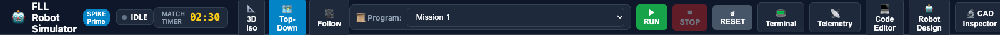
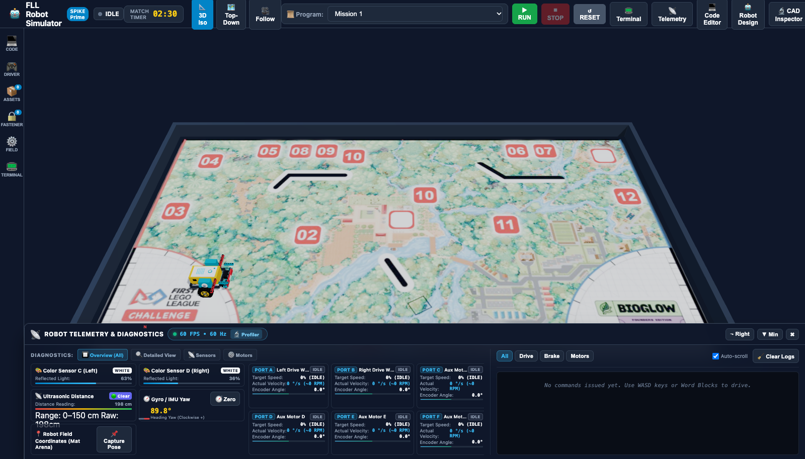
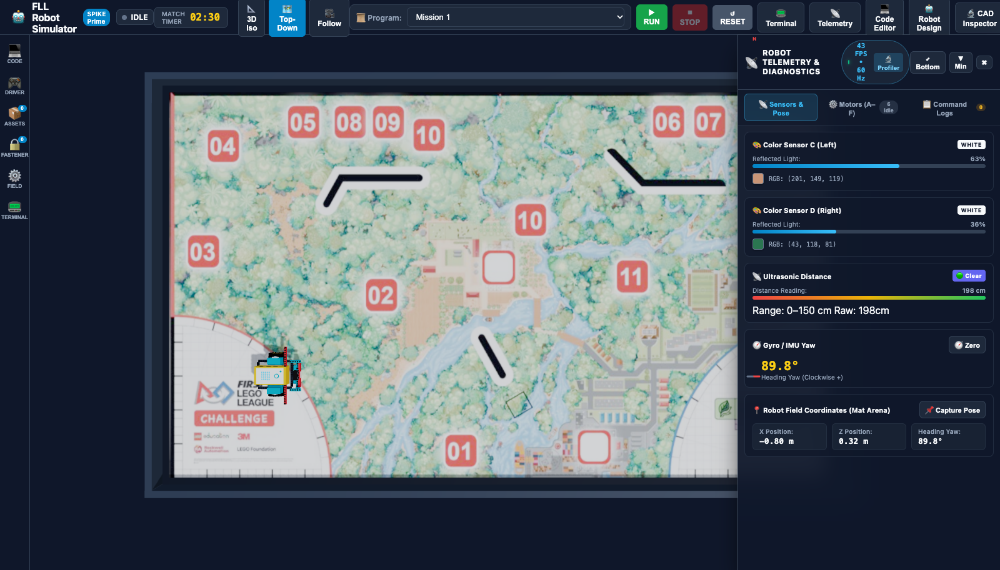
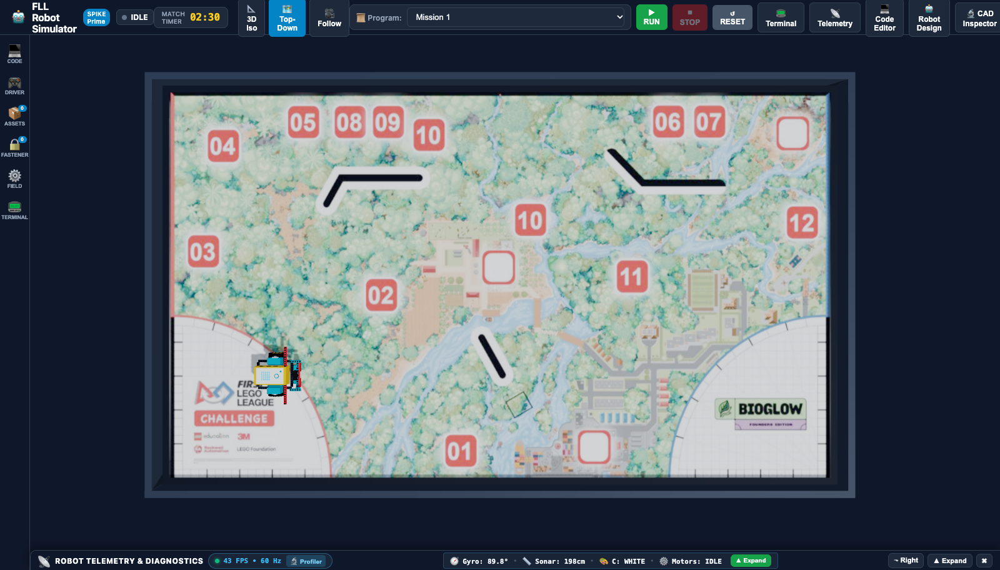
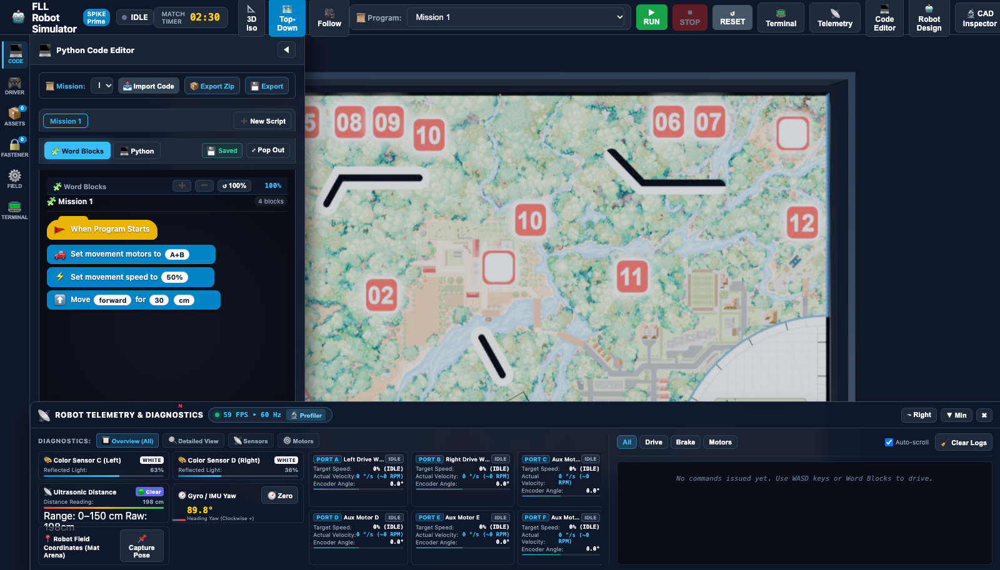
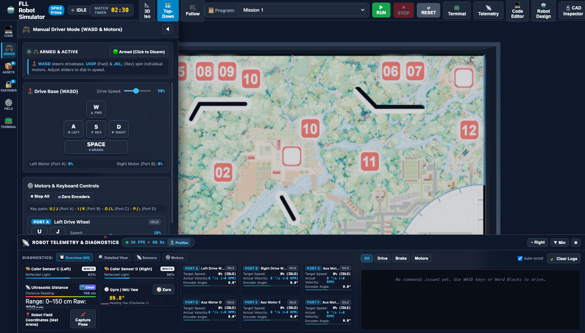
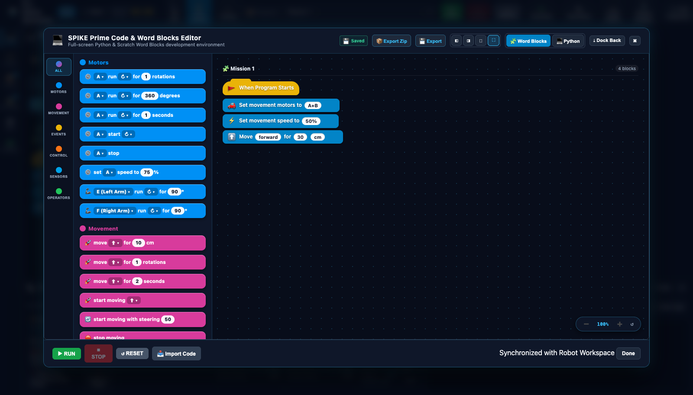
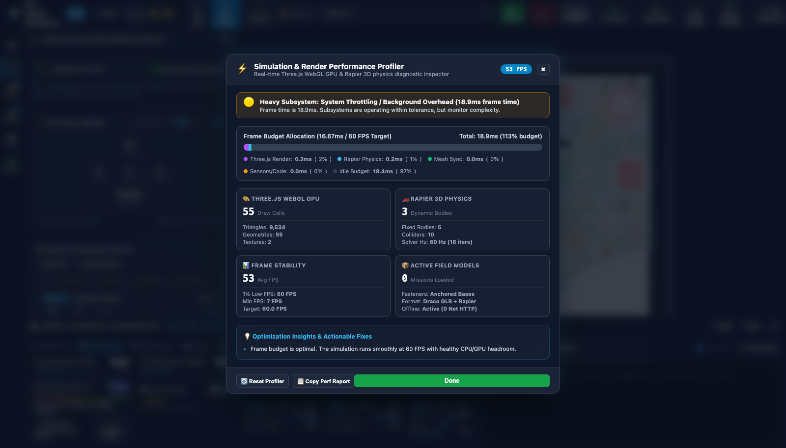

# 🖥️ UI Components & Global Controls Reference

The **FLL Robot Simulator (`fll-sim`)** features an authentic, competition-grade web graphical interface engineered specifically for FIRST® LEGO® League teams, mentors, and students. Built with Three.js (WebGL), Rapier3D physics (WebAssembly), and an authentic SPIKE™ Prime execution runtime, the simulator combines real-time 3D simulation with modular telemetry, interactive Scratch Word Blocks, Python programming, and CAD inspection.

This reference provides an exhaustive guide to every UI component, modal dialog, control surface, docking mode, telemetry feed, and keyboard shortcut available in the simulator.

---

## 1. Master Application Overview

The simulator interface is organized into five primary spatial zones designed for zero-clutter mission execution and fast debugging:


```
┌────────────────────────────────────────────────────────────────────────────────────────┐
│ [1] TOP NAVIGATION BAR & GLOBAL CONTROLS (Brand, Timer, Camera, Selector, Run, Modals) │
├───────┬───────────────────────────────┬────────────────────────────────────────────────┤
│       │                               │                                                │
│  [4]  │  [5] LEFT DRAWER              │  [2] 3D COMPETITION MAT VIEWPORT               │
│  LEFT │  (Code / Driver / Assets /    │      (Three.js WebGL Arena, Compass, Orbit)    │
│  ACT- │   Fasteners / Field / Term)   │                                                │
│  IVITY│                               │                                                │
│  BAR  │                               ├────────────────────────────────────────────────┤
│       │                               │  [3] DOCKABLE TELEMETRY PANE                   │
│ (48px)│  (380px – 760px Resizable)    │      (Sensors, Motors A–F, Command Log Stream) │
└───────┴───────────────────────────────┴────────────────────────────────────────────────┘
```

### Primary Layout Zones

1. **Top Navigation Bar (`.hud-topbar`)**: Always-visible 48px header containing brand identity, execution status, match countdown timer, camera angle presets, active program selector, script execution triggers (`RUN`, `STOP`, `RESET`), and modal quick-launch icons.
2. **3D Competition Mat Viewport (`#viewport-container`)**: High-performance Three.js WebGL rendering canvas simulating official 2362mm × 1143mm competition mats with physically accurate lighting, friction surfaces, drop reticles, and live robot kinematics.
3. **Dockable & Minimizable Telemetry Pane (`#hud-telemetry-dock`)**: Flexible diagnostics pane supporting horizontal bottom docking, vertical right docking, or a 30px minimized status bar. Houses live sensor meters, motor velocity cards, and real-time physics event logs.
4. **Left Activity Bar (`.hud-activity-bar`)**: Fixed 48px vertical rail providing single-click switching between functional workspaces: Code, Manual Driver, Asset Library, Fasteners, Field Setup, and Debug Terminal.
5. **Left Resizable Multi-Job Drawer (`#hud-drawer-panel`)**: Sliding secondary workspace resizable between 380px and 760px. Hosts embedded script editors, WASD manual driving, mission catalog loaders, and layout persistence controls.

!!! tip "Workspace Customization"
    All panels in the simulator can be resized, collapsed, or popped out into floating modals. On multi-monitor or widescreen displays, open the **Code Editor** and **CAD Inspector** in dedicated modal overlays while keeping the 3D Mat Viewport full-width.

---

## 2. Top Navigation Bar & Global Controls

The Top Navigation Bar provides central mission command and instant access to execution, timing, and system-wide diagnostic tools.



### Control Elements Breakdown

| Control Element | DOM Identifier / Selector | Function & Operational Description |
| :--- | :--- | :--- |
| **Brand & Logo** | `.hud-brand` | Displays platform branding with the **`SPIKE Prime`** indicator badge. |
| **Execution State Dot** | `#exec-status-dot`, `#exec-status-text` | Real-time VM status indicator. Transitions between: <br>• **`IDLE`** (Gray/White): Robot awaiting execution.<br>• **`RUNNING`** (Emerald Green, pulsing): Python VM actively evaluating bytecode.<br>• **`ERROR`** (Crimson Red): Runtime exception or syntax failure encountered. |
| **Match Countdown Timer** | `#hud-match-timer` | Official FIRST LEGO League **02:30** countdown clock. Syncs automatically when a program starts or manual driving begins. Click to start, pause, or reset. |
| **Camera View Presets** | `[data-cam="ISO"]`<br>`[data-cam="TOP_DOWN"]`<br>`[data-cam="FOLLOW"]` | One-click camera perspective triggers: <br>• **`📐 3D Iso`**: 45° isometric perspective for obstacle clearance.<br>• **`🗺️ Top-Down`**: Orthographic overhead view for precision grid alignment.<br>• **`🎥 Follow`**: Smooth chasing camera centered on robot coordinates. |
| **Active Mission Selector** | `#topbar-program-select` | Dropdown linking all open editor tabs and standard benchmark programs: <br>• `Mission 1: Drive Straight (30 cm)`<br>• `Mission 2: Gyro 90° Turn`<br>• `Mission 3: Proportional Line Follower`<br>• `Mission 4: Dual-Sensor Line Squaring` |
| **Run Program** | `#btn-topbar-run` | **`▶ RUN`** (Emerald Green). Compiles active Python or Word Blocks code and launches asynchronous execution. Hotkey: ++space++. |
| **Emergency Stop** | `#btn-topbar-stop` | **`⏹ STOP`** (Crimson Red). Instantly brakes all drive and auxiliary motors, terminates the Python worker thread, and holds robot position. Hotkey: ++space++ (while running). |
| **Reset Robot** | `#btn-topbar-reset` | **`↺ RESET`** (Amber Yellow). Immediately teleports the robot back to its active launch arc coordinates, clears motor encoders, and re-levels gyro heading. Hotkey: ++ctrl+space++ / ++cmd+space++. |
| **Terminal Modal** | `#btn-toggle-floating-terminal` | **`📟 Terminal`**. Toggles floating resizable stdout/stderr output console window. |
| **Telemetry Modal** | `#btn-toggle-telemetry` | **`📡 Telemetry`**. Expands or brings focus to the live diagnostics dock. |
| **Code Editor Modal** | `#btn-topbar-code` | **`💻 Code Editor`**. Pops out the SPIKE Prime Word Blocks Studio & Python Editor into a multi-column modal. |
| **Robot Design Modal** | `#btn-topbar-robot-design` | **`🤖 Robot Design`**. Opens robot architecture selection and hardware port configuration matrix. |
| **CAD Inspector Modal** | `#btn-topbar-inspector` | **`🔬 CAD Inspector`**. Launches deep 3D inspection, validation, and physics sandbox for `.io` and `.ldr` models. |

---

## 3. 3D Competition Mat Viewport & Camera Navigation

The 3D Competition Mat Viewport renders the physical competition table with millimeter accuracy, simulating official FLL mat dimensions (2362 mm × 1143 mm) bounded by rigid Baltic birch borders.



### Camera Perspectives & Orbit Navigation

The Three.js viewport provides three specialized camera modes:

=== "Top-Down View (Default)"
    * **Optimal For**: Line alignment, path planning, launch angle measurement, and 2D odometry tracking.
    * **Camera Orientation**: Positioned directly over field center `(0.0, 2.5, 0.0)` looking straight down with locked pitch.
    * **Reticle Interaction**: Drag the robot or mission models smoothly along the X/Z ground plane.

=== "Isometric 3D View"
    * **Optimal For**: Inspecting attachment clearance, vertical mission levers, gear meshing, and 3D collisions.
    * **Camera Orientation**: 45° azimuth, 35° elevation angled view showing depth and elevation profiles.
    * **Shadow & Depth**: Directional shadow maps highlight ground clearance and tire contact patches.

=== "Dynamic Follow Camera"
    * **Optimal For**: Long-distance navigation runs, obstacle traversal, and driver-perspective missions.
    * **Tracking Dynamics**: Automatically tracks the robot chassis centroid, maintaining an offset distance while damping high-frequency vibrations.

### Interactive Viewport Controls

* **Orbit Rotate**: Click and drag with ++left-button-click++ across the mat surface to orbit around the current focus target.
* **Pan Camera**: Click and drag with ++right-button-click++ (or ++ctrl+left-button-click++) to translate the camera target across the mat.
* **Smooth Zoom**: Scroll mouse wheel (++wheel-up++ / ++wheel-down++) or pinch-to-zoom on touchpads.
* **Object Placement & Dragging**: Click and hold on the robot or any unlocked mission element to enter positioning mode. A cyan drop reticle projects the exact ground footprint.
* **Keyboard In-Place Rotation**: While hovering or dragging any object, press ++r++ (clockwise +15°) or ++shift+r++ (counter-clockwise -15°) to rotate in place without moving coordinates.

### Dynamic 3D Compass & Heading Indicator

Positioned in the 3D viewport and telemetry cards, the dynamic compass renders:
* **North Needle (Crimson Red)**: Real-time absolute field alignment.
* **Digital Yaw Heading**: Live precision degrees with clockwise positive convention (`0.0°` to `359.9°` or `±180°`).
* **Heading Zero Button (`🧭 Zero`)**: Instantly resets the internal IMU software offset to `0.0°` relative to the robot's current heading.

---

## 4. Dockable & Minimizable Telemetry Pane

The Telemetry Pane provides real-time visibility into internal robot state, optical sensors, distance sonars, motor tachometers, and Rapier3D physics collision logs.

### Flexible Docking Configurations

The telemetry system supports three distinct operational layouts to fit any screen aspect ratio:

=== "Bottom Dock (2-Column Horizontal)"
    
    * **CSS Class**: `.dock-bottom`
    * **Layout**: Left column houses live sensor diagnostics and motor cards; right column streams physics commands and logs.
    * **Resizing**: Drag the top border resizer handle (`#telem-resizer-n`) vertically to expand height from 180px to 450px.

=== "Right Dock (Vertical Stack)"
    
    * **CSS Class**: `.dock-right`
    * **Layout**: Compact vertical column docked to the right edge. Tab navigation switches between **`Sensors`**, **`Motors (A–F)`**, and **`Command Logs`**.
    * **Resizing**: Drag the left border resizer handle (`#telem-resizer-w`) horizontally to adjust width from 320px to 600px.

=== "Minimized Bar Mode (30px Status Bar)"
    
    * **CSS Class**: `.minimized`
    * **Layout**: Collapses into a thin 30px bottom status strip displaying live mini summaries:
      `🧭 Gyro: 0.0° • 📏 Sonar: --cm • 🎨 C: WHITE • ⚙️ Motors: IDLE`
    * **Expand**: Click the **`▲ Expand`** button or the header toggle to restore full view.

---

### Diagnostic Cards Reference

```
┌─────────────────────────────────┬─────────────────────────────────┐
│ COLOR SENSOR C (LEFT)           │ COLOR SENSOR D (RIGHT)          │
│ Badge: WHITE                    │ Badge: BLACK                    │
│ Reflected Light: 98% [========] │ Reflected Light: 12% [=       ] │
│ Swatch: #FFFFFF  RGB(255,255,255│ Swatch: #1A1A1A  RGB(26,26,26)  │
├─────────────────────────────────┼─────────────────────────────────┤
│ ULTRASONIC DISTANCE SENSOR      │ GYRO / IMU YAW HEADING          │
│ Proximity: 🟢 Clear             │ Compass Dial: [ 🧭 90.0° ]      │
│ Reading: 42.5 cm [======    ]   │ Digital: 90.0° (Clockwise +)    │
│ Range: 0–150 cm  Raw: 425mm     │ Action: [🧭 Zero Gyro]          │
├─────────────────────────────────┴─────────────────────────────────┤
│ ROBOT FIELD COORDINATES (MAT ARENA)                               │
│ X Position: -0.80 m   │ Z Position: 0.32 m   │ Heading Yaw: 90.0° │
│ Actions: [📌 Capture Pose as Spawn]                               │
└───────────────────────────────────────────────────────────────────┘
```

#### 1. Dual Optical Color Sensors (Ports C & D)
* **Real-time Color Swatches**: Square preview box showing the exact ground pixel color sampled beneath each sensor aperture.
* **RGB Color Value**: Exact sampled 8-bit channels `RGB: (r, g, b)`.
* **Reflected Light Meter**: Proportional bar graph (0% to 100%) used for line following, intersection detection, and dual-sensor squaring.
* **Detected Color Badge**: Automatic classification matching official LEGO color tags: `WHITE`, `BLACK`, `RED`, `BLUE`, `YELLOW`, `GREEN`, or `NONE`.

#### 2. Ultrasonic Distance Sensor (Port E)
* **Distance Reading**: Calibrated reading from 0 cm to 150 cm.
* **Proximity Status Badge**:
  * 🟢 **`Clear`** (> 20 cm): Path unobstructed.
  * 🟡 **`Approaching`** (10 cm – 20 cm): Obstacle in braking range.
  * 🔴 **`Warning`** (< 10 cm): Imminent collision hazard.
* **Raw Distance Display**: Millimeter-precision internal raycast metric.

#### 3. Gyro / IMU Yaw Heading (Hub Gyro)
* **Rotational Dial**: Real-time rotating needle tracking robot chassis heading.
* **Digital Heading Metric**: Continuous precision floating-point angle (`-180.0°` to `+180.0°`).
* **Zero Button**: Instant recalibration to zero without altering physical position.

#### 4. Arena Coordinates & Pose Capture
* **Coordinates Grid**: Live tracking of chassis center of mass:
  * **X**: Millimeters from arena center line (`-1.18 m` to `+1.18 m`).
  * **Z**: Millimeters from arena south edge (`-0.57 m` to `+0.57 m`).
  * **Yaw**: Heading angle in degrees.
* **`📌 Capture Pose`**: Click to save the robot's current position and rotation as the new starting spawn point.

---

### Motor Diagnostics Cards (Ports A–F)

Each motor port card (A, B, C, D, E, F) renders real-time mechanical parameters:


* **Drive Motors (Ports A & B)**: Left and right drive wheels configured with differential kinematics.
* **Auxiliary Motors (Ports C–F)**: Medium and large angled motors driving mission manipulators, rack-and-pinion pushers, and gearboxes.
* **Telemetry Fields**:
  * **Target Power / Speed**: Programmed velocity setpoint (`-100%` to `+100%`).
  * **Actual Angular Velocity**: Real-time velocity reported in both degrees per second (`°/s`) and revolutions per minute (`RPM`).
  * **Cumulative Encoder Angle**: High-precision rotary tachometer reading with zeroing action (`↺ Zero`).

---

### Live Command & Physics Event Logs Stream

The right column of the telemetry dock streams real-time communication events between the Python runtime and the Rapier3D physics solver:

* **Category Filter Pills**:
  * **`All`**: Full execution transcript.
  * **`Drive`**: Movement commands (`move()`, `steer()`, `start_tank()`).
  * **`Brake`**: Mechanical stopping events (`stop()`, active holding torque).
  * **`Motors`**: Individual auxiliary motor actions (`run_for_degrees()`, `run_to_position()`).
* **Log Controls**:
  * **`Auto-scroll Checkbox`**: Automatically pins view to newest events.
  * **`🧹 Clear Logs`**: Empties memory buffer and clears log console.
* **Performance Badge**: Live pulsing badge displaying Three.js rendering frame rate (`60 FPS`) and physics engine frequency (`60 Hz`). Clicking opens the Performance Profiler.

---

## 5. Left Resizable Multi-Job Activity Bar & Drawer

The Left Drawer system houses specialized operational tools without occluding the main 3D arena.



### Activity Bar Views

| Icon | Name | Key Role & Features |
| :---: | :--- | :--- |
| 💻 | **Code** | Dual-mode SPIKE Prime Word Blocks and Python script editor with multi-tab management, autosave, and ZIP export. |
| 🎮 | **Driver** | Direct manual control interface with WASD keyboard steering, individual motor sliders, and live emergency braking. |
| 📦 | **Assets** | Mission model library for loading official season mission assemblies (`.io` / `.ldr`) and batch layout presets. |
| 🔒 | **Fasteners** | 3M™ Dual Lock fastener tool for placing, inspecting, and toggling fixed baseplate anchors. |
| ⚙️ | **Field** | Field surface selection (Numbered BioGlow, Grid, Procedural), simulation modes, spawn position coordinates, and offline caching. |
| 📟 | **Terminal** | Integrated stdout/stderr logging console for script print output and runtime debug messages. |

### Drawer Resizing Mechanism

Hover over the right vertical border of the drawer panel (`#hud-panel-resizer`) to reveal the horizontal resize cursor. Click and drag horizontally to resize anywhere between **380px** and **760px** width. The 3D viewport canvas automatically resizes with zero aspect ratio distortion.

---

### Manual Driver Mode (WASD & Motors)

Manual Driver Mode allows operators to manually steer the robot and test mission mechanisms using direct keyboard inputs:



#### 1. Drive Base Controls (WASD)
* ++w++: Drive straight forward at configured speed.
* ++s++: Drive straight backward in reverse.
* ++a++: Spin counter-clockwise in place (left motor reverse, right motor forward).
* ++d++: Spin clockwise in place (left motor forward, right motor reverse).
* ++space++: Instant emergency brake (both drive motors locked).
* **Speed Slider (`10% – 100%`)**: Sets baseline velocity for WASD driving actions.

#### 2. Individual Motor Keybindings (UIOP / JKL;)
Drive auxiliary attachments and individual motors directly from keyboard key pairs:

| Motor Port | Forward Key | Reverse Key | Default Role |
| :---: | :---: | :---: | :--- |
| **Port A** | ++u++ | ++j++ | Left Drive Wheel |
| **Port B** | ++i++ | ++k++ | Right Drive Wheel |
| **Port C** | ++o++ | ++l++ | Left Auxiliary Motor / Arm |
| **Port D** | ++p++ | ++;++ | Right Auxiliary Motor / Arm |

!!! note "Focus Safety"
    When typing inside code textareas, file input modals, or rename inputs, the driver mode automatically disarms key listeners to prevent accidental robot movement.

---

## 6. SPIKE Prime Word Blocks Studio & Python Editor

The code editor provides a complete, authentic FIRST LEGO League programming environment with full parity between Scratch-based Word Blocks and official SPIKE Prime Python code.



### Popout Modal Layout & Pin Modes

Clicking **`⤢ Pop Out`** or the topbar **`💻 Code Editor`** button expands the editor into an interactive modal overlay with specialized window docking controls:

* **Pin to Left (`◧`)**: Pins the code editor to the left 50% of the screen, keeping the 3D viewport active on the right 50%.
* **Pin to Right (`◨`)**: Pins the code editor to the right 50% of the screen.
* **Float Window (`🗗`)**: Centered 90% dialog box with modal backdrop.
* **Maximize (`⛶`)**: Fullscreen editor view.
* **Dock Back (`⤓`)**: Restores the editor into the left activity drawer.

---

### 3-Column Word Blocks Workspace

The visual programming workspace is structured after official LEGO Education SPIKE App 3.x:

```
┌─────────────────┬──────────────────────────┬────────────────────────────────────────┐
│ CATEGORY RAIL   │ BLOCK PALETTE DRAWER     │ INTERACTIVE CANVAS VIEWPORT            │
│                 │                          │                                        │
│ • [All]         │ [When Program Starts 🚩] │    [When Program Starts 🚩]            │
│ • [Motors]      │ [Move forward 10 cm  ⬆️] │               │                        │
│ • [Movement]    │ [Set speed to 50%    ⚡] │    [Set movement motors to A+B 🚗]      │
│ • [Events]      │ [Turn right 90 deg   ↻] │               │                        │
│ • [Control]     │ [Wait 1 seconds      ⏳] │    [Set speed to 50% ⚡]                │
│ • [Sensors]     │ [Motor A run 360 deg ⚙️] │               │                        │
│ • [Operators]   │                          │    [Move forward 30 cm ⬆️]             │
│                 │                          │                                        │
│                 │                          │              Zoom: [➖] [100%] [➕] [↺]│
└─────────────────┴──────────────────────────┴────────────────────────────────────────┘
```

1. **Category Sidebar (`.spike-category-sidebar`)**:
   * 🟦 **Motors (`#0090f5`)**: Individual motor velocity, relative positioning, and run-for-degrees.
   * 🟪 **Movement (`#d83b9c`)**: Differential drive base steering, centimeters/inches travel, and tank steering.
   * 🟨 **Events (`#ffab19`)**: Program launch hats (`when program starts`) and sensor trigger conditions.
   * 🟧 **Control (`#ffab19` / `#e67e22`)**: Loops (`repeat`, `forever`), conditional branching (`if-then-else`), and timers.
   * 🟦 **Sensors (`#00b5e2`)**: Color reflectivity tests, distance sonar thresholds, and gyro yaw angles.
   * 🟩 **Operators (`#40bf4a`)**: Mathematical arithmetic, comparisons (`<`, `>`, `=`), and boolean logic.
2. **Block Palette Drawer (`.spike-palette-drawer`)**: Displays authentic rounded blocks with dropdown parameter pills and editable input fields.
3. **Canvas Viewport (`.spike-canvas-viewport`)**: Infinite dotted canvas supporting pan and zoom. Features floating zoom controls:
   * **`➕` / `➖`**: Zoom in / out (supports mouse wheel zoom).
   * **`↺`**: Reset zoom to 100% and center stack.

---

### Dual-Mode Architecture & Project Management

* **Word Blocks ↔ Python Toggle**: Switch instantaneously between visual block stacks and equivalent Python syntax using the mode toggle buttons (`🧩 Word Blocks` vs `💻 Python`).
* **Autosave Status Indicator (`💾 Saved`)**: Automatically saves script modifications to browser local storage.
* **Multi-Tab Script Management**: Create and organize multiple programs with the **`➕ New Script`** tab bar.
* **Project Import / Export**:
  * **`📦 Export Zip`**: Bundles all active scripts and assets into a portable ZIP archive.
  * **`💾 Export`**: Downloads active program as `.py` or `.llsp3`.
  * **`📥 Import Code`**: Ingests official SPIKE 3 (`.llsp3`), legacy SPIKE 2 (`.llsp`), Scratch 3 (`.sb3`), or raw Python scripts.

---

## 7. Robot Design & Hardware Port Mapping Modal

The Robot Design Modal configures the simulated robot chassis, dimensions, wheel geometry, and hardware port assignments.


### Section A: Robot Architecture Selection

Choose between preconfigured competition driving bases or upload custom models:

```
┌────────────────────────────────────────┬────────────────────────────────────────┐
│ 🏎️ ADVANCED DRIVING BASE (DROIDBOT-E)  │ 🤖 COMPACT SPIKE BASE                  │
│ [ ACTIVE SELECTION ]                   │ [ SELECT BASE ]                        │
│ Dual drive motors (A+B), dual optical  │ Lightweight agile chassis designed     │
│ sensors (C+D), ultrasonic sonar (E),   │ for high-speed maneuvering and quick   │
│ rear ball caster, rigid Technic frame. │ cornering with lower center of mass.   │
│ Motors: 2 Drive + 2 Aux  Sensors: 3    │ Motors: 2 Drive  Sensors: Dual Color   │
└────────────────────────────────────────┴────────────────────────────────────────┘
```

* **`➕ Upload Robot CAD (.io / .ldr)`**: Loads custom robot designs created in BrickLink Studio or LeoCAD.
* **`🔬 Open in 3D CAD Inspector`**: Immediately jumps into the CAD validator for geometry and kinematic testing.

---

### Section B: Hardware Port Mapping Matrix

Configure logical port assignments matching physical robot wiring:

| Component Role | Assigned Port | Default | Hardware Type |
| :--- | :---: | :---: | :--- |
| **Drive Left Wheel** | `A` (A–F) | **Port A** | Large Technic Angular Motor (54 mm Wheel) |
| **Drive Right Wheel** | `B` (A–F) | **Port B** | Large Technic Angular Motor (54 mm Wheel) |
| **Auxiliary Attachment 1** | `C` (A–F) | **Port C** | Medium Technic Angular Motor |
| **Auxiliary Attachment 2** | `D` (A–F) | **Port D** | Medium Technic Angular Motor |
| **Auxiliary Attachment 3** | `E` (A–F) | **Port E** | Medium Technic Angular Motor |
| **Auxiliary Attachment 4** | `F` (A–F) | **Port F** | Medium Technic Angular Motor |
| **Left Color Sensor** | `C` (C, D, None) | **Port C** | SPIKE Prime Optical Color/Light Sensor |
| **Right Color Sensor** | `D` (C, D, None) | **Port D** | SPIKE Prime Optical Color/Light Sensor |
| **Ultrasonic Sensor** | `E` (E, F, None) | **Port E** | SPIKE Prime Ultrasonic Distance Sensor |
| **Internal 6-Axis IMU** | `HUB_GYRO` | **Fixed Bus** | Internal 3-Axis Gyroscope & Accelerometer |

All assignments persist automatically across browser sessions.

---

## 8. 3D CAD Model Inspector & Diagnostic Validator

The CAD Inspector provides engineering validation tools for examining LEGO models exported from BrickLink Studio (`.io`) or LDraw (`.ldr`).

### Robot Digital Twin Validation


### Competition Season Mission Inspection


---

### Validation & Kinematics Report Panel

The right column computes comprehensive structural metrics for the active model:

* **Model Geometry Status**:
  * ✅ **`MODEL GEOMETRY VALID`**: All parts topologically connected into rigid clusters.
  * ⚠️ **`UNANCHORED BODIES DETECTED`**: Loose parts detected that may fall under gravity.
* **Physical Metrics Summary**:
  * **Total LEGO Parts**: Total element count parsed from the file.
  * **Submodels**: Number of independent subassemblies identified.
  * **Kinematic Bodies**: Compound physics bodies generated by the topological solver.
  * **Estimated Mass**: Total assembly mass in grams based on official LEGO element weights.
* **Bounding Dimensions**:
  * **Width (X)**: Dimensions in millimeters and LEGO Technic studs.
  * **Depth (Z)**: Depth in millimeters and studs.
  * **Height (Y)**: Height in millimeters and vertical plate thicknesses.
  * **Ground Alignment**: Clearance verification (e.g., `Flush with mat +0.0 mm`).

---

### Interactive Visual & Physics Tools

* **Wireframe Mode (`🕸️ Wireframe: ON/OFF`)**: Renders polygon mesh edges for inspecting vertex density and geometry topology.
* **Colliders Wireframe (`🔲 Colliders: ON/OFF`)**: Displays exact Rapier3D collision hulls (compound cuboids, spheres, and convex hulls).
* **Live Physics Sandbox (`▶ Live Physics: ON/OFF`)**: Activates full gravity and collision solving inside the CAD preview.
* **Virtual Mouse Grab Tool (`✋ Grab`)**: Click and drag parts with interactive spring force to test hinge travel and mechanical limits.
* **Technic Push Bar (`🥢 Technic Bar`)**: Spawns an interactive LEGO beam probe to physically push levers, gears, and latches. Scroll the mouse wheel to raise or lower the probe height.
* **Assembly Step Build Mode (`🧱 Step Build Mode`)**: Step through official build instructions step-by-step with play, pause, and scrubber controls.

---

### Cluster Anchoring & Fasteners

The **Clusters** tab lists every rigid subassembly detected by the solver. Operators can dynamically anchor individual assemblies to the mat:

* **`📌 Fix Base Only`**: Anchors stationary baseplates to the mat while keeping levers, gears, and arms dynamic.
* **`🔓 All Movable`**: Makes all assemblies dynamic subject to gravity and impact forces.
* **`🔒 Lock All`**: Freezes the entire model as a stationary obstacle.
* **Interactive Nudge Controls**: Fine-tune cluster positions along X (±8 mm), Y (±3.2 mm), and Z (±8 mm) axes.

---

## 9. Simulation & Render Performance Profiler

The Performance Profiler provides real-time diagnostic telemetry for GPU rendering, physics solver timing, and memory allocation.



### Frame Budget Allocation (16.67ms / 60 FPS Target)

The stacked horizontal budget bar visualizes where frame time is spent relative to the 16.67 ms (60 FPS) budget:

```
┌────────────────────────────────────────────────────────────────────────┐
│ [Three.js: 5.8ms] [Rapier: 4.2ms] [Sync: 2.5ms] [Sensors: 0.8ms] [Idle]│
└────────────────────────────────────────────────────────────────────────┘
```

* **Three.js WebGL Render (`seg-render`, Cyan)**: GPU drawing time, shader passes, and mesh rendering.
* **Rapier 3D Physics (`seg-physics`, Indigo)**: Collision detection, velocity integration, and constraint resolution.
* **Visual & Mesh Sync (`seg-sync`, Purple)**: Synchronizing Rapier rigid body transforms with Three.js mesh instances.
* **Sensors & Script VM (`seg-sensors`, Amber)**: Python bytecode execution, raycast sensors, and optical color sampling.
* **Idle Headroom (`seg-idle`, Emerald)**: Spare frame time remaining before dropped frames occur.

---

### Subsystem Metrics Cards

| Metric Category | Target Value | Diagnostic Description |
| :--- | :---: | :--- |
| **Three.js WebGL GPU** | < 80 Draw Calls | Tracks active WebGL draw calls, rendered triangles, distinct geometries, and texture bindings. |
| **Rapier 3D Physics** | 60 Hz (16 iters) | Monitors active dynamic rigid bodies, fixed field colliders, and solver velocity iterations. |
| **Frame Stability** | 60.0 FPS | Measures rolling average FPS, 1% Low FPS (stutter detection), and minimum recorded FPS. |
| **Active Field Models** | 0 Network Calls | Reports loaded mission models, Draco GLB compression state, and offline cache hit rate. |

---

## 10. Global Keyboard Shortcuts Cheat Sheet

The simulator provides global hotkeys for hands-on competition training and keyboard-driven debugging:

### Program Execution & Mission Controls

| Shortcut | Context | Action Performed |
| :--- | :--- | :--- |
| ++space++ | Global (outside text inputs) | **Toggle Program Execution**: Start active program or trigger emergency stop. |
| ++ctrl+space++ / ++cmd+space++ | Global | **Reset Robot Pose**: Reset robot to launch coordinates and zero encoders. |
| ++escape++ | Modal dialog open | **Dismiss Modal**: Closes active modal window (Code, CAD Inspector, Profiler). |
| ++escape++ | Mission Element Selected | **Deselect Element**: Clears active 3D selection reticle. |
| ++r++ | Dragging or Hovering 3D Object | **Rotate Clockwise (+15°)**: Rotates robot or mission element in place. |
| ++shift+r++ | Dragging or Hovering 3D Object | **Rotate Counter-Clockwise (-15°)**: Rotates robot or mission element. |

---

### Manual Drive Base Hotkeys (Driver Mode Armed)

| Shortcut | Key | Drive Action |
| :---: | :---: | :--- |
| ++w++ | `W` | **Drive Forward**: Both drive motors forward at configured speed. |
| ++s++ | `S` | **Drive Reverse**: Both drive motors backward at configured speed. |
| ++a++ | `A` | **Spin Left**: Left motor reverse, right motor forward. |
| ++d++ | `D` | **Spin Right**: Left motor forward, right motor reverse. |
| ++space++ | `SPACE` | **Emergency Brake**: Stops and locks both drive motors. |

---

### Individual Motor Hotkeys (Driver Mode Armed)

| Forward Action | Reverse Action | Motor Port | Associated Physical Hardware |
| :---: | :---: | :---: | :--- |
| ++u++ | ++j++ | **Port A** | Drive Base Left Motor |
| ++i++ | ++k++ | **Port B** | Drive Base Right Motor |
| ++o++ | ++l++ | **Port C** | Auxiliary Attachment Arm 1 |
| ++p++ | ++;++ | **Port D** | Auxiliary Attachment Arm 2 |

---

### Viewport & Camera Navigation

| Input Action | Navigation Context | Effect |
| :--- | :--- | :--- |
| ++left-button-click++ + Drag | Viewport Canvas | **Orbit Camera**: Rotates viewing angle around center of interest. |
| ++right-button-click++ + Drag | Viewport Canvas | **Pan Camera**: Translates viewing target across the competition mat. |
| ++wheel-up++ / ++wheel-down++ | Viewport Canvas | **Zoom Viewport**: Smoothly zooms camera in or out. |
| ++wheel-up++ / ++wheel-down++ | Word Blocks Canvas | **Zoom Blocks**: Zooms visual block workspace canvas. |
| ++wheel-up++ / ++wheel-down++ | CAD Inspector (Technic Tool) | **Adjust Tool Height**: Raises or lowers the Technic probe bar. |

---

## Summary & Next Steps

With this UI reference, team members can navigate every control surface of the FLL Robot Simulator. For next steps and practical exercises, explore:

* [**Tutorial Learning Path**](../tutorials/index.md): Complete curriculum for team training.
* [**Tutorial 1: Getting Started & Mat Navigation**](../tutorials/01_getting_started.md): Hands-on walkthrough of mat navigation and robot positioning.
* [**Tutorial 2: SPIKE Word Blocks Programming**](../tutorials/02_word_blocks_programming.md): Building competition runs with Scratch blocks.
* [**Advance Driving Base Guide**](../guides/advance_driving_base.md): Hardware specifications of the competition robot.
* [**SPIKE Python API Reference**](../guides/spike_python.md): Programming guide for Python scripts.
* [**CAD Import Guide**](../guides/cad_import.md): Importing `.io` and `.ldr` models into the simulator.
