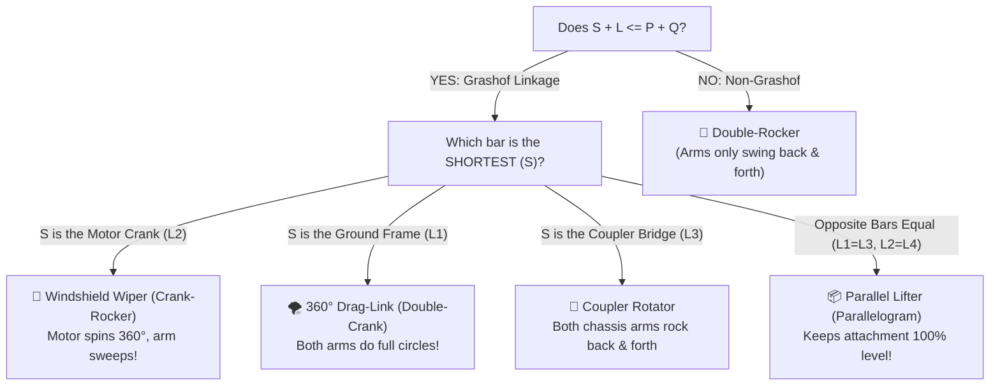

# 🛠️ LEGO® Technic 4-Bar Linkage Motion Simulator

Welcome to the **FLL Robot Simulator Interactive Worksheets**! This motion simulator lets FIRST LEGO League (FLL) teams, coaches, and students build, visualize, and experiment with **Four-Bar Linkages** using authentic **LEGO® Technic beam sizes** (measured in holes, not metric units).

---

## 🎯 What is a 4-Bar Linkage & What Problems Does It Solve?

A **four-bar linkage** is one of the most powerful and popular mechanical inventions in robotics. It consists of four rigid bars connected together by four pivot pins in a closed loop:

1. **One bar stays fixed** to your robot chassis (the **Ground Frame**).
2. **One bar is turned by your motor** (the **Driver / Crank**).
3. **The third bar floats in the air** (the **Bridge / Coupler**).
4. **The fourth bar swings and does the work** (the **Follower / Rocker**).

```
          [Pivot B] ──────── Coupler Bar (Yellow) ──────── [Pivot C]
             /                                                 \
    Crank   /                                                   \   Follower
    (Red)  /                                                     \  (Blue)
          /                                                       \
      [Pivot A] ════════════ Ground Base (Grey) ══════════════ [Pivot D]
       (Motor)                                                (Pivot)
```

### 💡 Why do FLL teams use 4-Bar Linkages?

* **Keep Cargo Level (Parallel Lifter)**: If opposite bars have the same length, your attachment will lift straight up without tilting. Your game pieces won't slide off!
* **Reach Far Over Obstacles**: A linkage can lift an arm up, reach over a tall mission wall, and drop down directly on top of a mission model.
* **Turn Spinning Motors into Pushing / Kicking**: A motor spins in continuous circles. A 4-bar linkage turns that spinning circle into back-and-forth flapping, swiping, or kicking without complex gear trains!
* **Snap & Lock (Toggle Clamps)**: When bars straighten out, they can lock into place with huge mechanical leverage, holding heavy mission levers without your SPIKE motor stalling.

---

## 🎮 Interactive 4-Bar Linkage Simulator

Use the controls below to pick your LEGO Technic beam lengths. Drag the red motor crank directly with your mouse or finger, or hit **`▶ Play`** to watch the mechanism move!

<div id="fourbar-simulator-container" class="fourbar-sim-wrapper">
  <div class="fourbar-topbar">
    <div class="fourbar-control-group">
      <label for="linkage-preset-select"><strong>⚡ Quick FLL Presets:</strong></label>
      <select id="linkage-preset-select" class="fourbar-select">
        <option value="parallel_lifter">📦 Parallel Forklift (Keeps Claws Level)</option>
        <option value="windshield_wiper" selected>🚗 Windshield Wiper (Crank-Rocker 360°)</option>
        <option value="chebyshev_walker">🚶 Chebyshev Walking Leg (Straight-Line Step)</option>
        <option value="high_reach_dumper">🚜 High-Reach Dumping Bucket</option>
        <option value="quick_return_shifter">⚡ Quick-Return Snap Lever</option>
        <option value="double_rocker_swing">🚪 Double-Rocker Swing Gate</option>
      </select>
    </div>
    <div class="fourbar-badge-container">
      <span id="grashof-badge" class="fourbar-badge badge-success">✅ Crank-Rocker</span>
      <span id="transmission-badge" class="fourbar-badge badge-info">Angle: 85° (Optimal)</span>
    </div>
  </div>

  <!-- Main 2-column interactive layout -->
  <div class="fourbar-main-grid">
    <!-- Left Column: Interactive Canvas -->
    <div class="fourbar-canvas-card">
      <div class="fourbar-canvas-toolbar">
        <div class="canvas-btn-row">
          <button id="btn-play-pause" class="fb-btn fb-btn-primary">▶ Play</button>
          <button id="btn-reverse" class="fb-btn fb-btn-secondary" title="Reverse Rotation Direction">⟲ Reverse</button>
          <button id="btn-reset-angle" class="fb-btn fb-btn-secondary" title="Reset Crank Angle to 0°">↺ Reset</button>
          <button id="btn-clear-trail" class="fb-btn fb-btn-secondary" title="Clear motion tracer trail">✨ Clear Trail</button>
        </div>
        <div class="canvas-toggle-row">
          <label class="fb-checkbox-label">
            <input type="checkbox" id="chk-trace" checked> 📍 Trace Path
          </label>
          <label class="fb-checkbox-label">
            <input type="checkbox" id="chk-lego-style" checked> 🧱 LEGO Style
          </label>
          <label class="fb-checkbox-label">
            <input type="checkbox" id="chk-branch"> 🔀 Crossed
          </label>
        </div>
      </div>

      <div class="canvas-viewport-wrapper">
        <canvas id="fourbar-canvas" width="700" height="460"></canvas>
        <div id="canvas-overlay-alert" class="canvas-alert" style="display:none;"></div>
      </div>

      <div class="canvas-scrubber-row">
        <label for="slider-crank-angle"><strong>Motor Crank Angle:</strong> <span id="val-crank-deg">45°</span></label>
        <input type="range" id="slider-crank-angle" min="0" max="360" value="45" step="1" class="fb-range">
      </div>
    </div>

    <!-- Right Column: LEGO Beam Length Selectors -->
    <div class="fourbar-sidebar-card">
      <h3 style="margin-top:0; margin-bottom: 8px;">📏 LEGO® Beam Lengths (Holes)</h3>
      <p style="font-size: 0.85rem; color: var(--md-default-fg-color--light); margin-bottom: 12px;">
        1 hole unit = 1 LEGO stud pitch (8 mm). Measured center-to-center between pivot pins.
      </p>

      <!-- Ground Bar L1 -->
      <div class="beam-input-row" style="border-left: 4px solid #64748B;">
        <div class="beam-header">
          <span class="beam-name" style="color: #64748B;"><strong>1. Ground Frame (L₁)</strong></span>
          <span class="beam-metric" id="metric-ground">9 holes (72 mm)</span>
        </div>
        <div class="beam-controls">
          <button class="fb-step-btn" data-target="ground" data-delta="-1">-</button>
          <input type="range" id="input-ground" min="2" max="21" value="9" step="1" class="fb-range">
          <button class="fb-step-btn" data-target="ground" data-delta="1">+</button>
        </div>
        <div class="quick-pill-row">
          <button class="quick-pill" data-target="ground" data-val="5">5H</button>
          <button class="quick-pill" data-target="ground" data-val="7">7H</button>
          <button class="quick-pill active" data-target="ground" data-val="9">9H</button>
          <button class="quick-pill" data-target="ground" data-val="11">11H</button>
          <button class="quick-pill" data-target="ground" data-val="13">13H</button>
          <button class="quick-pill" data-target="ground" data-val="15">15H</button>
        </div>
      </div>

      <!-- Crank Bar L2 -->
      <div class="beam-input-row" style="border-left: 4px solid #EF4444;">
        <div class="beam-header">
          <span class="beam-name" style="color: #EF4444;"><strong>2. Motor Crank (L₂)</strong></span>
          <span class="beam-metric" id="metric-crank">3 holes (24 mm)</span>
        </div>
        <div class="beam-controls">
          <button class="fb-step-btn" data-target="crank" data-delta="-1">-</button>
          <input type="range" id="input-crank" min="2" max="15" value="3" step="1" class="fb-range">
          <button class="fb-step-btn" data-target="crank" data-delta="1">+</button>
        </div>
        <div class="quick-pill-row">
          <button class="quick-pill" data-target="crank" data-val="2">2H</button>
          <button class="quick-pill active" data-target="crank" data-val="3">3H</button>
          <button class="quick-pill" data-target="crank" data-val="4">4H</button>
          <button class="quick-pill" data-target="crank" data-val="5">5H</button>
          <button class="quick-pill" data-target="crank" data-val="7">7H</button>
        </div>
      </div>

      <!-- Coupler Bar L3 -->
      <div class="beam-input-row" style="border-left: 4px solid #F59E0B;">
        <div class="beam-header">
          <span class="beam-name" style="color: #F59E0B;"><strong>3. Coupler Bridge (L₃)</strong></span>
          <span class="beam-metric" id="metric-coupler">8 holes (64 mm)</span>
        </div>
        <div class="beam-controls">
          <button class="fb-step-btn" data-target="coupler" data-delta="-1">-</button>
          <input type="range" id="input-coupler" min="2" max="21" value="8" step="1" class="fb-range">
          <button class="fb-step-btn" data-target="coupler" data-delta="1">+</button>
        </div>
        <div class="quick-pill-row">
          <button class="quick-pill" data-target="coupler" data-val="5">5H</button>
          <button class="quick-pill" data-target="coupler" data-val="7">7H</button>
          <button class="quick-pill active" data-target="coupler" data-val="8">8H</button>
          <button class="quick-pill" data-target="coupler" data-val="10">10H</button>
          <button class="quick-pill" data-target="coupler" data-val="13">13H</button>
        </div>
      </div>

      <!-- Follower Bar L4 -->
      <div class="beam-input-row" style="border-left: 4px solid #3B82F6;">
        <div class="beam-header">
          <span class="beam-name" style="color: #3B82F6;"><strong>4. Follower Rocker (L₄)</strong></span>
          <span class="beam-metric" id="metric-follower">7 holes (56 mm)</span>
        </div>
        <div class="beam-controls">
          <button class="fb-step-btn" data-target="follower" data-delta="-1">-</button>
          <input type="range" id="input-follower" min="2" max="21" value="7" step="1" class="fb-range">
          <button class="fb-step-btn" data-target="follower" data-delta="1">+</button>
        </div>
        <div class="quick-pill-row">
          <button class="quick-pill" data-target="follower" data-val="5">5H</button>
          <button class="quick-pill active" data-target="follower" data-val="7">7H</button>
          <button class="quick-pill" data-target="follower" data-val="9">9H</button>
          <button class="quick-pill" data-target="follower" data-val="11">11H</button>
          <button class="quick-pill" data-target="follower" data-val="15">15H</button>
        </div>
      </div>

      <!-- Live Grashof Math Box -->
      <div class="grashof-info-box">
        <div class="grashof-title"><strong>🔍 The Shortest + Longest Test:</strong></div>
        <div id="grashof-math-line" class="grashof-formula">
          Shortest (3) + Longest (9) = 12 &nbsp;≤&nbsp; Others (7 + 8) = 15
        </div>
        <div id="grashof-simple-msg" class="grashof-msg">
          🎉 <strong>The motor can spin non-stop in complete 360° circles!</strong>
        </div>
      </div>
    </div>
  </div>
</div>

<style>
.fourbar-sim-wrapper {
  background: var(--md-code-bg-color, #1e293b);
  border: 1px solid var(--md-default-fg-color--lightest, #334155);
  border-radius: 12px;
  padding: 18px;
  margin: 20px 0;
  box-shadow: 0 8px 24px rgba(0, 0, 0, 0.2);
  color: var(--md-default-fg-color, #e2e8f0);
}
.fourbar-topbar {
  display: flex;
  justify-content: space-between;
  align-items: center;
  flex-wrap: wrap;
  gap: 12px;
  margin-bottom: 14px;
  padding-bottom: 12px;
  border-bottom: 1px solid var(--md-default-fg-color--lightest, #334155);
}
.fourbar-control-group {
  display: flex;
  align-items: center;
  gap: 8px;
}
.fourbar-select {
  background: #0f172a;
  color: #f8fafc;
  border: 1px solid #475569;
  border-radius: 6px;
  padding: 6px 12px;
  font-size: 0.9rem;
  font-weight: 500;
  cursor: pointer;
}
.fourbar-badge-container {
  display: flex;
  gap: 8px;
  flex-wrap: wrap;
}
.fourbar-badge {
  display: inline-block;
  padding: 4px 10px;
  border-radius: 20px;
  font-size: 0.8rem;
  font-weight: 600;
}
.badge-success { background: rgba(16, 185, 129, 0.2); color: #34d399; border: 1px solid #059669; }
.badge-warning { background: rgba(245, 158, 11, 0.2); color: #fbbf24; border: 1px solid #d97706; }
.badge-danger { background: rgba(239, 68, 68, 0.2); color: #f87171; border: 1px solid #dc2626; }
.badge-info { background: rgba(59, 130, 246, 0.2); color: #60a5fa; border: 1px solid #2563eb; }

.fourbar-main-grid {
  display: grid;
  grid-template-columns: 1.35fr 1fr;
  gap: 18px;
}
@media (max-width: 960px) {
  .fourbar-main-grid { grid-template-columns: 1fr; }
}

.fourbar-canvas-card, .fourbar-sidebar-card {
  background: #0f172a;
  border: 1px solid #334155;
  border-radius: 8px;
  padding: 12px;
}
.fourbar-canvas-toolbar {
  display: flex;
  justify-content: space-between;
  align-items: center;
  flex-wrap: wrap;
  gap: 8px;
  margin-bottom: 8px;
}
.canvas-btn-row, .canvas-toggle-row {
  display: flex;
  align-items: center;
  gap: 6px;
}
.fb-btn {
  padding: 5px 12px;
  border-radius: 6px;
  font-size: 0.85rem;
  font-weight: 600;
  cursor: pointer;
  border: 1px solid transparent;
  transition: all 0.15s ease;
}
.fb-btn-primary { background: #3b82f6; color: white; }
.fb-btn-primary:hover { background: #2563eb; }
.fb-btn-secondary { background: #1e293b; color: #cbd5e1; border-color: #475569; }
.fb-btn-secondary:hover { background: #334155; }
.fb-checkbox-label {
  font-size: 0.8rem;
  color: #94a3b8;
  cursor: pointer;
  display: flex;
  align-items: center;
  gap: 4px;
}

.canvas-viewport-wrapper {
  position: relative;
  background: #090d16;
  border: 1px solid #1e293b;
  border-radius: 6px;
  overflow: hidden;
  height: 420px;
}
#fourbar-canvas {
  width: 100%;
  height: 100%;
  display: block;
  cursor: grab;
}
#fourbar-canvas:active { cursor: grabbing; }

.canvas-alert {
  position: absolute;
  top: 12px;
  left: 12px;
  right: 12px;
  background: rgba(220, 38, 38, 0.9);
  color: white;
  padding: 8px 12px;
  border-radius: 6px;
  font-size: 0.85rem;
  font-weight: 600;
  text-align: center;
  backdrop-filter: blur(4px);
}
.canvas-scrubber-row {
  margin-top: 10px;
  display: flex;
  flex-direction: column;
  gap: 4px;
  font-size: 0.85rem;
}

.beam-input-row {
  background: #1e293b;
  border-radius: 6px;
  padding: 8px 10px;
  margin-bottom: 10px;
}
.beam-header {
  display: flex;
  justify-content: space-between;
  align-items: center;
  font-size: 0.85rem;
  margin-bottom: 4px;
}
.beam-metric {
  color: #94a3b8;
  font-family: monospace;
}
.beam-controls {
  display: flex;
  align-items: center;
  gap: 8px;
}
.fb-step-btn {
  background: #334155;
  color: #f8fafc;
  border: none;
  border-radius: 4px;
  width: 26px;
  height: 26px;
  font-weight: bold;
  cursor: pointer;
}
.fb-step-btn:hover { background: #475569; }
.fb-range {
  flex: 1;
  cursor: pointer;
}
.quick-pill-row {
  display: flex;
  gap: 4px;
  margin-top: 6px;
}
.quick-pill {
  background: #0f172a;
  color: #94a3b8;
  border: 1px solid #334155;
  border-radius: 4px;
  font-size: 0.72rem;
  padding: 2px 6px;
  cursor: pointer;
}
.quick-pill:hover, .quick-pill.active {
  background: #38bdf8;
  color: #0f172a;
  border-color: #38bdf8;
  font-weight: bold;
}

.grashof-info-box {
  background: #1e293b;
  border: 1px solid #334155;
  border-radius: 6px;
  padding: 10px;
  margin-top: 12px;
}
.grashof-title { font-size: 0.85rem; color: #cbd5e1; margin-bottom: 4px; }
.grashof-formula { font-family: monospace; font-size: 0.85rem; color: #38bdf8; margin-bottom: 6px; }
.grashof-msg { font-size: 0.82rem; color: #34d399; line-height: 1.4; }
</style>

<script>
(function() {
  // 4-Bar Kinematics Logic in Vanilla JS
  const PRESETS = {
    parallel_lifter: { ground: 9, crank: 5, coupler: 9, follower: 5, angle: 45, tracer: { along: 4.5, perp: 3 }, crossed: false },
    windshield_wiper: { ground: 9, crank: 3, coupler: 8, follower: 7, angle: 45, tracer: { along: 4, perp: 0 }, crossed: false },
    chebyshev_walker: { ground: 8, crank: 4, coupler: 10, follower: 10, angle: 90, tracer: { along: 5, perp: -4 }, crossed: false },
    high_reach_dumper: { ground: 10, crank: 5, coupler: 12, follower: 8, angle: 30, tracer: { along: 12, perp: 4 }, crossed: false },
    quick_return_shifter: { ground: 11, crank: 4, coupler: 10, follower: 7, angle: 45, tracer: { along: 5, perp: 0 }, crossed: false },
    double_rocker_swing: { ground: 13, crank: 8, coupler: 7, follower: 9, angle: 70, tracer: { along: 3.5, perp: 2 }, crossed: false }
  };

  let state = {
    ground: 9,
    crank: 3,
    coupler: 8,
    follower: 7,
    crankAngleDeg: 45,
    isPlaying: false,
    speed: 1.5,
    direction: 1, // 1 = CW, -1 = CCW
    tracePath: true,
    legoStyle: true,
    isCrossed: false,
    trail: [],
    prevC: null,
    tracerOffset: { along: 4, perp: 0 },
    isDragging: false
  };

  // DOM Elements
  const canvas = document.getElementById('fourbar-canvas');
  if (!canvas) return;
  const ctx = canvas.getContext('2d');

  const presetSelect = document.getElementById('linkage-preset-select');
  const grashofBadge = document.getElementById('grashof-badge');
  const transmissionBadge = document.getElementById('transmission-badge');
  const btnPlay = document.getElementById('btn-play-pause');
  const btnReverse = document.getElementById('btn-reverse');
  const btnReset = document.getElementById('btn-reset-angle');
  const btnClearTrail = document.getElementById('btn-clear-trail');
  const chkTrace = document.getElementById('chk-trace');
  const chkLegoStyle = document.getElementById('chk-lego-style');
  const chkBranch = document.getElementById('chk-branch');
  const sliderAngle = document.getElementById('slider-crank-angle');
  const valAngle = document.getElementById('val-crank-deg');
  const overlayAlert = document.getElementById('canvas-overlay-alert');

  const inputGround = document.getElementById('input-ground');
  const inputCrank = document.getElementById('input-crank');
  const inputCoupler = document.getElementById('input-coupler');
  const inputFollower = document.getElementById('input-follower');

  const metricGround = document.getElementById('metric-ground');
  const metricCrank = document.getElementById('metric-crank');
  const metricCoupler = document.getElementById('metric-coupler');
  const metricFollower = document.getElementById('metric-follower');

  const grashofFormula = document.getElementById('grashof-math-line');
  const grashofSimpleMsg = document.getElementById('grashof-simple-msg');

  // Kinematics solver
  function solvePose(theta2Rad, prevC) {
    const { ground, crank, coupler, follower, isCrossed } = state;
    const pA = { x: 0, y: 0 };
    const pD = { x: ground, y: 0 };

    const bx = crank * Math.cos(theta2Rad);
    const by = crank * Math.sin(theta2Rad);
    const pB = { x: bx, y: by };

    const isParallelogram = Math.abs(ground - coupler) < 1e-4 && Math.abs(crank - follower) < 1e-4;
    if (isParallelogram && !isCrossed) {
      const pC = { x: bx + ground, y: by };
      const frac = state.tracerOffset.along / coupler;
      const pP = { x: bx + frac * ground, y: by + state.tracerOffset.perp };
      return { pA, pB, pC, pD, pP, isValid: true, muDeg: 90 };
    }

    const dx = ground - bx;
    const dy = -by;
    const dBD = Math.hypot(dx, dy);

    if (dBD > coupler + follower || dBD < Math.abs(coupler - follower) || dBD < 1e-5) {
      return { pA, pB, pC: pB, pD, pP: pB, isValid: false, muDeg: 0 };
    }

    const a1 = (coupler * coupler - follower * follower + dBD * dBD) / (2 * dBD);
    const h = Math.sqrt(Math.max(0, coupler * coupler - a1 * a1));

    const ux = dx / dBD;
    const uy = dy / dBD;
    const vx = -uy;
    const vy = ux;

    const cand1 = { x: bx + a1 * ux + h * vx, y: by + a1 * uy + h * vy };
    const cand2 = { x: bx + a1 * ux - h * vx, y: by + a1 * uy - h * vy };

    let pC;
    if (prevC) {
      const d1 = Math.hypot(cand1.x - prevC.x, cand1.y - prevC.y);
      const d2 = Math.hypot(cand2.x - prevC.x, cand2.y - prevC.y);
      pC = d1 <= d2 ? cand1 : cand2;
    } else {
      pC = isCrossed ? cand2 : cand1;
    }

    // Transmission angle mu
    const vBCx = pC.x - bx, vBCy = pC.y - by;
    const vDCx = pC.x - ground, vDCy = pC.y;
    const dot = vBCx * vDCx + vBCy * vDCy;
    const magBC = Math.hypot(vBCx, vBCy), magDC = Math.hypot(vDCx, vDCy);
    const cosMu = Math.max(-1, Math.min(1, dot / (magBC * magDC)));
    const muDeg = (Math.acos(cosMu) * 180) / Math.PI;

    // Tracer point P
    const alongFrac = state.tracerOffset.along / coupler;
    const basePx = bx + alongFrac * vBCx;
    const basePy = by + alongFrac * vBCy;
    const normBCx = -vBCy / magBC;
    const normBCy = vBCx / magBC;
    const pP = {
      x: basePx + state.tracerOffset.perp * normBCx,
      y: basePy + state.tracerOffset.perp * normBCy
    };

    return { pA, pB, pC, pD, pP, isValid: true, muDeg };
  }

  function updateGrashofAnalysis() {
    const { ground, crank, coupler, follower } = state;
    const arr = [
      { name: 'ground', len: ground },
      { name: 'crank', len: crank },
      { name: 'coupler', len: coupler },
      { name: 'follower', len: follower }
    ].sort((a, b) => a.len - b.len);

    const S = arr[0], L = arr[3], P = arr[1], Q = arr[2];
    const sumSL = S.len + L.len;
    const sumPQ = P.len + Q.len;

    const isPara = Math.abs(ground - coupler) < 1e-4 && Math.abs(crank - follower) < 1e-4;

    if (L.len > S.len + P.len + Q.len) {
      grashofBadge.className = 'fourbar-badge badge-danger';
      grashofBadge.textContent = '❌ Impossible Linkage';
      grashofFormula.textContent = `Longest (${L.len}) > Sum of other 3 (${S.len + P.len + Q.len})`;
      grashofSimpleMsg.innerHTML = '⚠️ <strong>The bars are too short to bridge the gap!</strong>';
      overlayAlert.style.display = 'block';
      overlayAlert.textContent = '⚠️ Geometric Jam: Bars are too short to connect!';
      return;
    }

    overlayAlert.style.display = 'none';
    const isGrashof = sumSL <= sumPQ;

    grashofFormula.textContent = `Shortest (${S.len}) + Longest (${L.len}) = ${sumSL} ${isGrashof ? '≤' : '>'} Others (${P.len} + ${Q.len}) = ${sumPQ}`;

    if (isPara) {
      grashofBadge.className = 'fourbar-badge badge-success';
      grashofBadge.textContent = '✅ Parallelogram';
      grashofSimpleMsg.innerHTML = '🎉 <strong>Parallel Lifter!</strong> The floating bar stays at the exact same angle the whole time (great for forklifts!).';
    } else if (isGrashof) {
      if (S.name === 'crank') {
        grashofBadge.className = 'fourbar-badge badge-success';
        grashofBadge.textContent = '✅ Crank-Rocker';
        grashofSimpleMsg.innerHTML = '🎉 <strong>Windshield Wiper!</strong> The motor can spin non-stop in 360° circles while the output arm wags back & forth.';
      } else if (S.name === 'ground') {
        grashofBadge.className = 'fourbar-badge badge-success';
        grashofBadge.textContent = '✅ Double-Crank';
        grashofSimpleMsg.innerHTML = '🎉 <strong>360° Spinner!</strong> Both arms can spin in complete circles at varying speeds.';
      } else {
        grashofBadge.className = 'fourbar-badge badge-warning';
        grashofBadge.textContent = '⚠️ Double-Rocker';
        grashofSimpleMsg.innerHTML = '🎡 <strong>Playground Swing!</strong> The motor cannot spin 360°—the arms rock back and forth.';
      }
    } else {
      grashofBadge.className = 'fourbar-badge badge-warning';
      grashofBadge.textContent = '⚠️ Triple-Rocker';
      grashofSimpleMsg.innerHTML = '🛑 <strong>Double Swinger!</strong> S + L > P + Q. No bar can spin full circles; arms swing between limits.';
    }
  }

  function render() {
    const width = canvas.clientWidth || 700;
    const height = canvas.clientHeight || 420;
    const dpr = window.devicePixelRatio || 1;

    if (canvas.width !== width * dpr || canvas.height !== height * dpr) {
      canvas.width = width * dpr;
      canvas.height = height * dpr;
    }

    ctx.save();
    ctx.scale(dpr, dpr);
    ctx.clearRect(0, 0, width, height);

    // Grid background
    drawGrid(width, height);

    // Compute coordinate mapping: Ground pivot A at ~30% width, ground pivot D at 30% + scale*ground
    const maxDim = Math.max(state.ground + state.coupler + state.crank, 24);
    const scale = Math.min((width * 0.7) / maxDim, (height * 0.65) / maxDim);
    const originX = width * 0.28;
    const originY = height * 0.62;

    const toScreen = (pt) => ({
      x: originX + pt.x * scale,
      y: originY - pt.y * scale
    });

    const thetaRad = (state.crankAngleDeg * Math.PI) / 180;
    const pose = solvePose(thetaRad, state.prevC);
    if (pose.isValid) {
      state.prevC = pose.pC;
      if (state.tracePath) {
        state.trail.push(toScreen(pose.pP));
        if (state.trail.length > 280) state.trail.shift();
      }

      // Update transmission badge
      const dev = Math.abs(pose.muDeg - 90);
      transmissionBadge.textContent = `Transmission: ${pose.muDeg.toFixed(0)}°`;
      if (dev <= 25) {
        transmissionBadge.className = 'fourbar-badge badge-success';
      } else if (dev <= 50) {
        transmissionBadge.className = 'fourbar-badge badge-warning';
      } else {
        transmissionBadge.className = 'fourbar-badge badge-danger';
        transmissionBadge.textContent += ' ⚠️ Jamming Risk';
      }
    }

    // Draw tracer path trail
    if (state.trail.length > 1) {
      ctx.beginPath();
      ctx.moveTo(state.trail[0].x, state.trail[0].y);
      for (let i = 1; i < state.trail.length; i++) {
        ctx.lineTo(state.trail[i].x, state.trail[i].y);
      }
      ctx.strokeStyle = '#10B981';
      ctx.lineWidth = 3;
      ctx.setLineDash([4, 4]);
      ctx.stroke();
      ctx.setLineDash([]);
    }

    const scrA = toScreen(pose.pA);
    const scrB = toScreen(pose.pB);
    const scrC = toScreen(pose.pC);
    const scrD = toScreen(pose.pD);
    const scrP = toScreen(pose.pP);

    // Draw Beams
    if (state.legoStyle) {
      // 1. Ground Beam
      drawLegoBeam(scrA, scrD, state.ground, '#64748B', scale, true);
      // 2. Crank Beam (Red)
      drawLegoBeam(scrA, scrB, state.crank, '#EF4444', scale, false);
      // 3. Follower Beam (Blue)
      drawLegoBeam(scrD, scrC, state.follower, '#3B82F6', scale, false);
      // 4. Coupler Beam (Yellow)
      drawLegoBeam(scrB, scrC, state.coupler, '#F59E0B', scale, false);
      // 5. Tracer Arm / Tool (Green)
      if (state.tracePath) {
        ctx.beginPath();
        ctx.moveTo((scrB.x + scrC.x) / 2, (scrB.y + scrC.y) / 2);
        ctx.lineTo(scrP.x, scrP.y);
        ctx.strokeStyle = '#10B981';
        ctx.lineWidth = 4;
        ctx.stroke();
        drawPin(scrP, '#10B981', 6);
      }
    } else {
      // Clean wireframe mode
      drawSimpleLine(scrA, scrD, '#64748B', 8);
      drawSimpleLine(scrA, scrB, '#EF4444', 6);
      drawSimpleLine(scrB, scrC, '#F59E0B', 6);
      drawSimpleLine(scrD, scrC, '#3B82F6', 6);
    }

    // Draw Joints & Pins
    drawBaseAnchor(scrA, 'A (Motor)');
    drawBaseAnchor(scrD, 'D (Pivot)');
    drawMovingPin(scrB, 'B (Crank)');
    drawMovingPin(scrC, 'C (Coupler)');

    ctx.restore();
  }

  function drawGrid(w, h) {
    ctx.strokeStyle = '#162032';
    ctx.lineWidth = 1;
    const step = 24;
    for (let x = 0; x < w; x += step) {
      ctx.beginPath(); ctx.moveTo(x, 0); ctx.lineTo(x, h); ctx.stroke();
    }
    for (let y = 0; y < h; y += step) {
      ctx.beginPath(); ctx.moveTo(0, y); ctx.lineTo(w, y); ctx.stroke();
    }
  }

  function drawLegoBeam(p1, p2, holes, color, scale, isGround) {
    const dx = p2.x - p1.x, dy = p2.y - p1.y;
    const len = Math.hypot(dx, dy);
    const angle = Math.atan2(dy, dx);
    const beamThickness = Math.max(14, scale * 0.85);

    ctx.save();
    ctx.translate(p1.x, p1.y);
    ctx.rotate(angle);

    // Rounded Technic Beam Body
    ctx.beginPath();
    ctx.lineCap = 'round';
    ctx.lineWidth = beamThickness;
    ctx.strokeStyle = color;
    ctx.moveTo(0, 0);
    ctx.lineTo(len, 0);
    ctx.stroke();

    // Darker outline
    ctx.lineWidth = beamThickness + 2;
    ctx.strokeStyle = 'rgba(0,0,0,0.3)';
    ctx.stroke();

    // Beam Inner Fill
    ctx.lineWidth = beamThickness - 2;
    ctx.strokeStyle = color;
    ctx.stroke();

    // Circular LEGO Holes spaced evenly along the beam
    const holeRadius = Math.max(3, beamThickness * 0.24);
    const step = len / holes;
    for (let i = 0; i <= holes; i++) {
      const hx = i * step;
      ctx.beginPath();
      ctx.arc(hx, 0, holeRadius, 0, Math.PI * 2);
      ctx.fillStyle = '#090d16';
      ctx.fill();
      ctx.strokeStyle = 'rgba(255,255,255,0.2)';
      ctx.lineWidth = 1;
      ctx.stroke();
    }

    ctx.restore();
  }

  function drawSimpleLine(p1, p2, color, width) {
    ctx.beginPath();
    ctx.moveTo(p1.x, p1.y);
    ctx.lineTo(p2.x, p2.y);
    ctx.strokeStyle = color;
    ctx.lineWidth = width;
    ctx.lineCap = 'round';
    ctx.stroke();
  }

  function drawBaseAnchor(p, label) {
    // Triangle base ground support
    ctx.beginPath();
    ctx.moveTo(p.x, p.y);
    ctx.lineTo(p.x - 12, p.y + 18);
    ctx.lineTo(p.x + 12, p.y + 18);
    ctx.closePath();
    ctx.fillStyle = '#334155';
    ctx.fill();
    ctx.strokeStyle = '#94a3b8';
    ctx.lineWidth = 2;
    ctx.stroke();

    drawPin(p, '#000000', 8);

    ctx.fillStyle = '#cbd5e1';
    ctx.font = 'bold 11px sans-serif';
    ctx.textAlign = 'center';
    ctx.fillText(label, p.x, p.y + 32);
  }

  function drawMovingPin(p, label) {
    drawPin(p, '#0f172a', 8);
    drawPin(p, '#38bdf8', 4);

    ctx.fillStyle = '#f8fafc';
    ctx.font = '11px sans-serif';
    ctx.textAlign = 'center';
    ctx.fillText(label, p.x, p.y - 12);
  }

  function drawPin(p, color, r) {
    ctx.beginPath();
    ctx.arc(p.x, p.y, r, 0, Math.PI * 2);
    ctx.fillStyle = color;
    ctx.fill();
    ctx.strokeStyle = '#ffffff';
    ctx.lineWidth = 1.5;
    ctx.stroke();
  }

  // Animation Loop
  let animId = null;
  function loop() {
    if (state.isPlaying) {
      state.crankAngleDeg = (state.crankAngleDeg + state.speed * state.direction) % 360;
      if (state.crankAngleDeg < 0) state.crankAngleDeg += 360;
      sliderAngle.value = Math.round(state.crankAngleDeg);
      valAngle.textContent = Math.round(state.crankAngleDeg) + '°';
    }
    render();
    animId = requestAnimationFrame(loop);
  }

  // Event Listeners
  btnPlay.addEventListener('click', () => {
    state.isPlaying = !state.isPlaying;
    btnPlay.textContent = state.isPlaying ? '⏸ Pause' : '▶ Play';
    btnPlay.className = state.isPlaying ? 'fb-btn fb-btn-secondary' : 'fb-btn fb-btn-primary';
  });

  btnReverse.addEventListener('click', () => {
    state.direction *= -1;
  });

  btnReset.addEventListener('click', () => {
    state.crankAngleDeg = 0;
    sliderAngle.value = 0;
    valAngle.textContent = '0°';
    state.trail = [];
    state.prevC = null;
    render();
  });

  btnClearTrail.addEventListener('click', () => {
    state.trail = [];
    render();
  });

  chkTrace.addEventListener('change', (e) => {
    state.tracePath = e.target.checked;
    if (!state.tracePath) state.trail = [];
    render();
  });

  chkLegoStyle.addEventListener('change', (e) => {
    state.legoStyle = e.target.checked;
    render();
  });

  chkBranch.addEventListener('change', (e) => {
    state.isCrossed = e.target.checked;
    state.trail = [];
    state.prevC = null;
    render();
  });

  sliderAngle.addEventListener('input', (e) => {
    state.crankAngleDeg = parseFloat(e.target.value);
    valAngle.textContent = Math.round(state.crankAngleDeg) + '°';
    render();
  });

  // Slider inputs for beams
  function syncBeamInputs() {
    metricGround.textContent = `${state.ground} holes (${state.ground * 8} mm)`;
    metricCrank.textContent = `${state.crank} holes (${state.crank * 8} mm)`;
    metricCoupler.textContent = `${state.coupler} holes (${state.coupler * 8} mm)`;
    metricFollower.textContent = `${state.follower} holes (${state.follower * 8} mm)`;

    inputGround.value = state.ground;
    inputCrank.value = state.crank;
    inputCoupler.value = state.coupler;
    inputFollower.value = state.follower;

    updateGrashofAnalysis();
    state.trail = [];
    state.prevC = null;
    render();
  }

  inputGround.addEventListener('input', (e) => { state.ground = parseInt(e.target.value); syncBeamInputs(); });
  inputCrank.addEventListener('input', (e) => { state.crank = parseInt(e.target.value); syncBeamInputs(); });
  inputCoupler.addEventListener('input', (e) => { state.coupler = parseInt(e.target.value); syncBeamInputs(); });
  inputFollower.addEventListener('input', (e) => { state.follower = parseInt(e.target.value); syncBeamInputs(); });

  // Stepper buttons
  document.querySelectorAll('.fb-step-btn').forEach(btn => {
    btn.addEventListener('click', () => {
      const target = btn.dataset.target;
      const delta = parseInt(btn.dataset.delta);
      state[target] = Math.max(2, Math.min(24, state[target] + delta));
      syncBeamInputs();
    });
  });

  // Quick pills
  document.querySelectorAll('.quick-pill').forEach(pill => {
    pill.addEventListener('click', () => {
      const target = pill.dataset.target;
      state[target] = parseInt(pill.dataset.val);
      syncBeamInputs();
      pill.parentElement.querySelectorAll('.quick-pill').forEach(p => p.classList.remove('active'));
      pill.classList.add('active');
    });
  });

  // Preset selector
  presetSelect.addEventListener('change', (e) => {
    const p = PRESETS[e.target.value];
    if (p) {
      state.ground = p.ground;
      state.crank = p.crank;
      state.coupler = p.coupler;
      state.follower = p.follower;
      state.crankAngleDeg = p.angle;
      state.tracerOffset = p.tracer;
      state.isCrossed = p.crossed;
      chkBranch.checked = p.crossed;
      sliderAngle.value = p.angle;
      valAngle.textContent = p.angle + '°';
      syncBeamInputs();
    }
  });

  // Mouse drag interaction to spin crank directly
  canvas.addEventListener('mousedown', (e) => {
    const rect = canvas.getBoundingClientRect();
    const mx = e.clientX - rect.left;
    const my = e.clientY - rect.top;

    const width = canvas.clientWidth;
    const height = canvas.clientHeight;
    const originX = width * 0.28;
    const originY = height * 0.62;

    const dx = mx - originX;
    const dy = originY - my; // invert Y
    const deg = (Math.atan2(dy, dx) * 180) / Math.PI;
    state.crankAngleDeg = (deg + 360) % 360;
    sliderAngle.value = Math.round(state.crankAngleDeg);
    valAngle.textContent = Math.round(state.crankAngleDeg) + '°';
    state.isDragging = true;
    render();
  });

  window.addEventListener('mousemove', (e) => {
    if (!state.isDragging) return;
    const rect = canvas.getBoundingClientRect();
    const mx = e.clientX - rect.left;
    const my = e.clientY - rect.top;

    const width = canvas.clientWidth;
    const height = canvas.clientHeight;
    const originX = width * 0.28;
    const originY = height * 0.62;

    const dx = mx - originX;
    const dy = originY - my;
    const deg = (Math.atan2(dy, dx) * 180) / Math.PI;
    state.crankAngleDeg = (deg + 360) % 360;
    sliderAngle.value = Math.round(state.crankAngleDeg);
    valAngle.textContent = Math.round(state.crankAngleDeg) + '°';
    render();
  });

  window.addEventListener('mouseup', () => { state.isDragging = false; });

  // Initial setup
  syncBeamInputs();
  loop();
})();
</script>

---

## 🧠 The 4 Parts of Every Linkage (For 10-Year-Old Builders)

Think of a four-bar linkage like four friends holding hands in a playground circle:

| Bar Name | Color in Simulator | LEGO Equivalent | What Does It Do? |
| :--- | :--- | :--- | :--- |
| **1. Ground Frame ($L_1$)** | 🪨 **Slate Grey** | Chassis / Robot Frame | The stationary foundation. Bolted firmly to the robot base so it never moves. |
| **2. Motor Crank ($L_2$)** | 🔴 **Bright Red** | Short Liftarm on Motor Axle | The driver! Connected directly to your SPIKE Prime motor to get turned in circles. |
| **3. Coupler Bridge ($L_3$)** | 🟡 **Bright Yellow** | Floating Cross Beam | The bridge! Never connects to the robot chassis; floats through the air connecting the crank to the follower. |
| **4. Follower Rocker ($L_4$)** | 🔵 **Bright Blue** | Output Working Arm | The tool! Swings, kicks, or lifts your competition attachment. |

---

## 🔮 The "Spin or Swing" Test (Grashof's Rule Made Simple!)

Have you ever built a cool mechanism with your motor, only to turn it on and have the motor immediately get stuck and groan `bzzzzz`? That happens when your bar lengths don't follow **Grashof's Rule**!

You can test whether your LEGO beams can do a full $360^\circ$ circle in 10 seconds:

```
Step 1: Measure all 4 bars by counting their holes.
Step 2: Find the Shortest bar (S) and Longest bar (L). Add them: S + L
Step 3: Add the other two bars together: P + Q
```

$$\mathbf{S + L \le P + Q} \quad \implies \quad \text{The shortest bar can do a complete } 360^\circ \text{ cartwheel!}$$

$$\mathbf{S + L > P + Q} \quad \implies \quad \text{Nobody can spin! All bars can only swing back and forth.}$$

### The 4 Linkage Personalities



1. **The Windshield Wiper (Crank-Rocker)**:
   * **How to build it**: Make your motor crank ($L_2$) the shortest bar.
   * **What it does**: Your motor can spin non-stop in one direction, while the output arm sweeps back and forth smoothly! Perfect for pushing obstacles or sweeping mission elements into scoring zones.
2. **The Parallel Lifter (Parallelogram)**:
   * **How to build it**: Make opposite bars the exact same hole count (e.g., Ground = 9H, Coupler = 9H; Crank = 5H, Follower = 5H).
   * **What it does**: As the motor lifts the arm, the coupler bar stays at the exact same horizontal angle through the entire swing. No spilled cargo!
3. **The Walking Leg (Chebyshev Straight-Line)**:
   * **How to build it**: Proportions like Ground = 8H, Crank = 4H, Coupler = 10H, Follower = 10H.
   * **What it does**: The tip of the coupler travels in a flat, straight line along the ground, then lifts up, arcs forward, and steps down again. It turns a circular motor into a walking robot!
4. **The Playground Swing (Triple-Rocker / Non-Grashof)**:
   * **How to build it**: $S + L > P + Q$.
   * **What it does**: The motor cannot make a full spin. If you try, it will jam and stall. You must program the motor to rotate forward $60^\circ$, stop, and rotate backward $60^\circ$.

---

## ⚠️ Real-Life LEGO® Caveats & Gotchas

Building linkages in computer software is easy, but real plastic LEGO bricks have quirks! Here are the 4 biggest traps FLL teams fall into:

### 1. Dead Points & Toggle Locks
When two bars straighten out into a single flat line ($180^\circ$), your linkage hits a **Dead Point** (like reaching the very top of a Ferris wheel). If your motor pushes on the bar when it's completely straight, it won't know whether to fold up or down!
* **The Fix**: Never design your attachment so the motor has to push through a perfectly straight line under load. Use mechanical stop pins so the linkage never flattens beyond $165^\circ$.

### 2. Friction Pins vs Friction-Less Pins
* **❌ The Mistake**: Using **Black or Blue friction pins** with little ridges on moving joints.
* **Why it hurts**: 4 friction pins add up to huge resistance. Your SPIKE motor will draw 1.5 Amps, overheat, and drain your battery!
* **✅ The Fix**: ALWAYS use **smooth Light-Grey or Tan friction-less pins** (or smooth axles with bushings) for the pivot joints!

### 3. Pin Slop & Backlash
Every LEGO pin hole has about $0.15\,\text{mm}$ of wiggle room so pins can slide in easily. But when you chain 4 bars together:
$$4 \times 0.15\,\text{mm} = 0.6\,\text{mm} \text{ of play at the joints!}$$
By the time that wiggle reaches the tip of a long 15-hole arm, the claw might wobble by **$5\text{ to }10\,\text{mm}$**!
* **The Fix**: Build **"sandwich" joints (Double-Shear)**: place two thin liftarms on either side of the pivot pin rather than hanging a heavy arm off a single pin.

### 4. Bar Collisions (Layering in 3D)
In 2D diagrams, bars pass right through each other like ghosts. In real life, LEGO beams are $7.8\,\text{mm}$ thick! If two beams try to cross the same path, they will smash into each other and crack!
* **The Fix**: Build each bar on a different **layer (plane)** using axle bushings or half-stud spacers so they slide past each other cleanly.

### 5. Transmission Angle & Mechanical Jamming (Firgelli Rule)
One of the most important concepts in real machine design (highlighted by industrial motion companies like FIRGELLI Automations) is the **Transmission Angle ($\mu$)**:
* **What is it?**: The angle between the floating Coupler bar (Yellow) and the Follower arm (Blue).
* **The Sweet Spot ($90^\circ$)**: When the coupler pushes at a right angle ($90^\circ$), 100% of the motor's force turns into rotational leverage!
* **The Danger Zone ($< 30^\circ$ or $> 150^\circ$)**: If the transmission angle gets too shallow, the coupler is pushing almost directly along the length of the follower arm. Instead of rotating the arm, it squeezes straight into the pivot pin! This creates huge friction, binds the mechanism, and stalls your motor.
* **The Rule of Thumb**: Keep your transmission angle between **$40^\circ$ and $140^\circ$** across the entire movement!

### 6. Rotary Motors vs Linear Actuators
* **Rotary Drive (FLL Style)**: In FLL robotics, your SPIKE Prime motor usually turns the red crank bar ($L_2$) directly on its axle.
* **Linear Actuator Drive (Industrial Style)**: In construction diggers, car hood lifts, and TV lifts, an electric linear actuator or hydraulic piston pushes between a mounting bracket and the crank arm. The 4-bar geometry converts the extending rod's straight push into a swinging or curling rotation!

---

## 🚜 Real-Life Machines Using 4-Bar Linkages

You see 4-bar linkages every single day in the real world:

* **Car Windshield Wipers**: A tiny continuous electric motor under the hood spins full circles, while a 4-bar linkage sweeps the wiper blades back and forth across your windshield.
* **Excavator Backhoes & Bulldozers**: Look closely at the metal bucket on an excavator. The hydraulic cylinder doesn't connect directly to the bucket; it pushes a 4-bar linkage so the bucket curls all the way in and scoops dirt!
* **Anglepoise Desk Lamps**: The parallel spring-loaded arms keep the lampshade pointing downward no matter how high or low you pull the lamp.
* **Airplane Landing Gear**: Heavy commercial jets use **toggle linkages** that snap into a dead-lock when wheels extend. Even if the hydraulic pumps lose all power, the mechanical toggle lock prevents the wheels from folding during landing!
* **Oil Well "Nodding Donkeys"**: The giant counterweighted beam in oil fields is a crank-rocker mechanism pumping oil from underground.

---

## 📚 Want to Learn More? (Deep Dives & Math References)

For older students, high school mentors, and coaches who want to explore the engineering mathematics behind linkages:

* [**FIRGELLI Automations: Four-Bar Linkage Calculator & Guide**](https://www.firgelliauto.com/blogs/engineering-calculators/four-bar-linkage-calculator): An outstanding engineering calculator and technical article by Robbie Dickson covering circle intersection methods, vector loop closure, acute transmission angle limits, and linear actuator driving.
* [**Grashof's Condition (Wikipedia)**](https://en.wikipedia.org/wiki/Chebyshev%27s_linkage): Comprehensive mathematical proof of the four-bar planar revolute mobility theorem.
* [**Freudenstein's Equation**](https://en.wikipedia.org/wiki/Freudenstein%27s_equation): The foundational algebraic equation developed by Ferdinand Freudenstein relating input and output angles of a four-bar linkage.
* [**507 Mechanical Movements**](http://507movements.com/): Classic mechanical encyclopedia with animated illustrations of cams, linkages, ratchets, and gears.
* [**Chebyshev's Lambda Mechanism**](https://en.wikipedia.org/wiki/Chebyshev%27s_linkage): How Russian mathematician Pafnuty Chebyshev discovered how to generate straight-line motion without rails or sliding tracks.
* [**Yoshihito Isogawa's LEGO Technic Idea Books**](https://isogawastudio.net/): Visual bibles of hundreds of working mechanical contraptions, linkages, and gearboxes built with standard LEGO parts.
* [**Sariel's LEGO Technic Gear & Mechanics Guide**](https://sariel.pl/): In-depth physical tutorials on mechanical advantage, gear ratios, and Technic building techniques.
